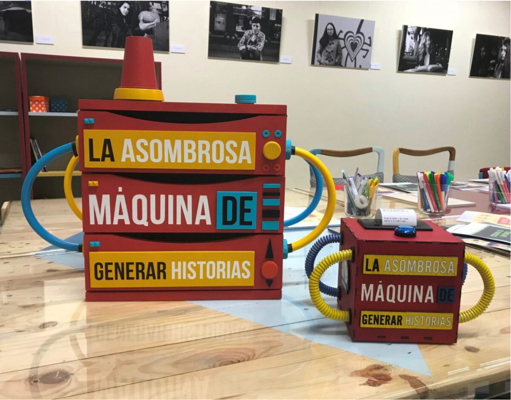
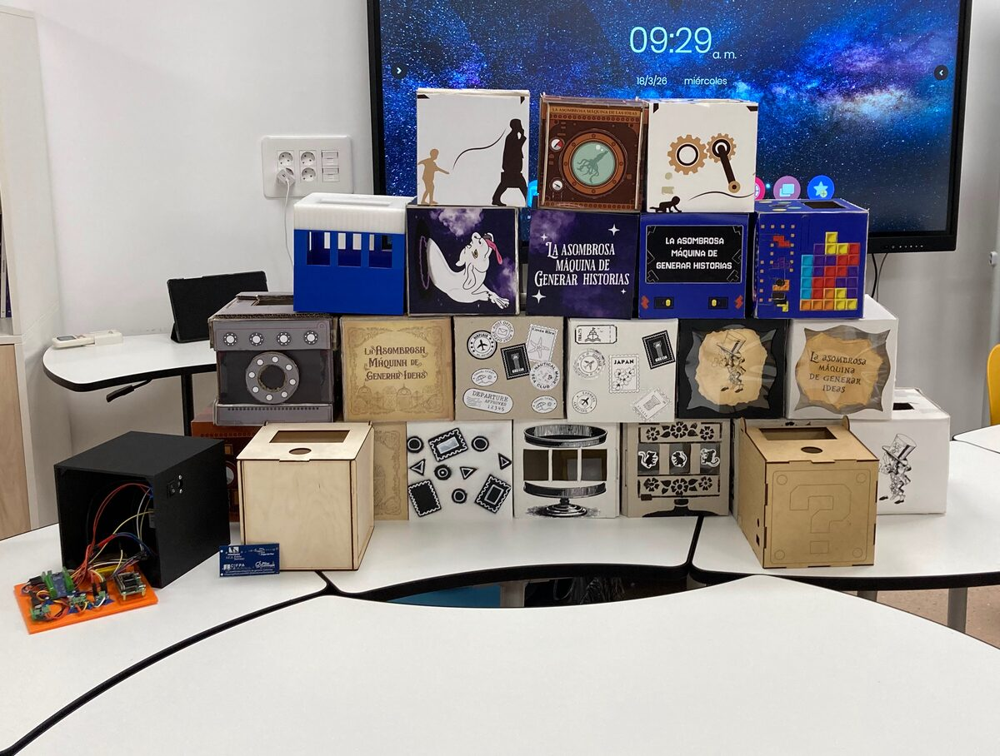
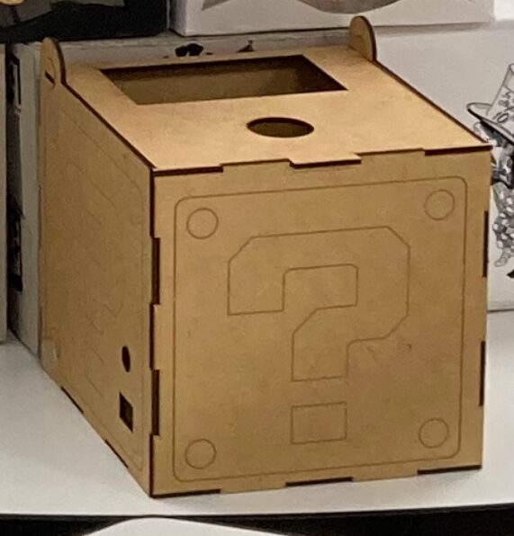
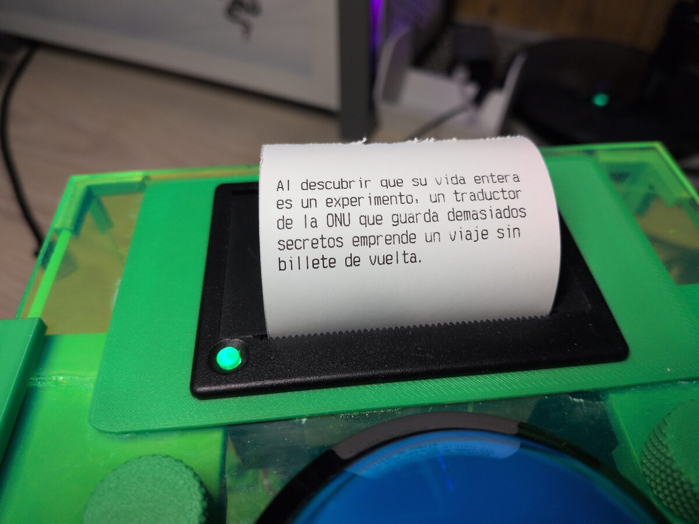
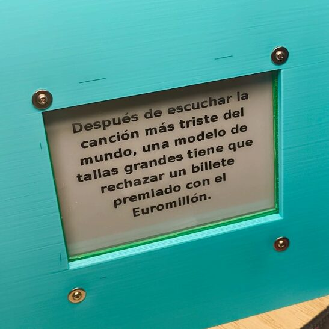
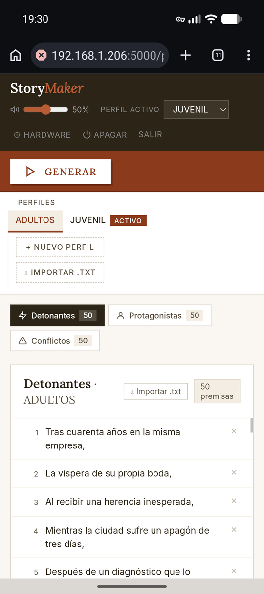
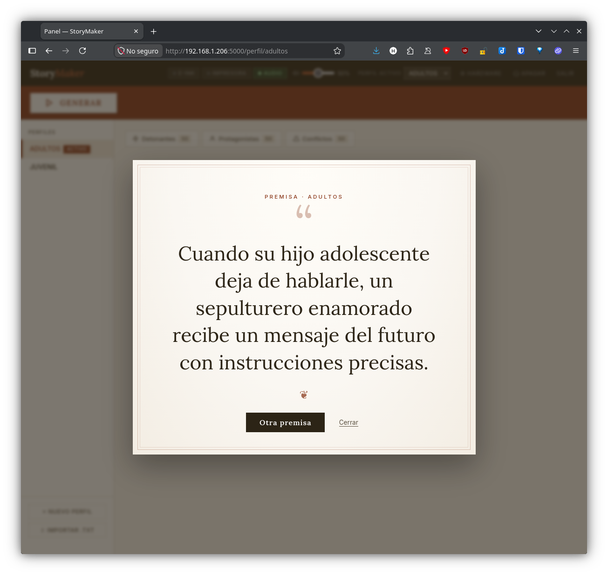
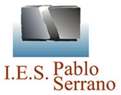

# La asombrosa máquina de generar historias

 

**Pulsas un botón y la máquina te da el arranque de una historia. Tú tienes
que continuarla.**

Es un aparato para talleres de escritura y fomento de la lectura. Lo ha hecho
la asociación Atrapavientos con alumnado y profesorado de FP de tres
institutos de Aragón, de Andorra y Zaragoza, y en este repositorio está todo
lo necesario para construir una: el programa, la placa, las cajas y los
manuales.

> **¿Has llegado aquí escaneando un QR?** Es el de la máquina, el que sale al
> apagarla o en el tique de despedida. Estás en el sitio correcto.

| | | | | |
|:-:|:-:|:-:|:-:|:-:|
|  |  |  |  |  |
| Una caja cualquiera... | ...que imprime historias | o las muestra en pantalla | y se maneja desde el móvil | o desde el PC |

**Centros participantes**

| | | | |
|:-:|:-:|:-:|:-:|
|  |  |  |  |
| IES Pablo Serrano Andorra (Teruel), centro coordinador | IES Virgen del Pilar Zaragoza | IES Pilar Lorengar Zaragoza | CIFPA Organiza los proyectos de innovación en FP |

---

## ¿Qué quieres hacer?

### Ya tengo una máquina y quiero usarla en clase

Enchúfala, espera a que el LED se quede fijo y pulsa el botón. Todo lo demás,
cambiar las frases, preparar un perfil para cada grupo o apagarla bien, está
en el **[manual de usuario](docs/manuales/usuario.md)**. No hace falta saber
nada de informática. Para tenerlo a mano en el aula hay una
**[guía rápida](docs/manuales/guia-rapida.pdf)** de una hoja, para imprimir.

### Quiero construir una

> **No hay que programar nada.** El programa viene ya instalado en una imagen
> de tarjeta: la descargas, la grabas con Raspberry Pi Imager (un programa
> gratuito de Raspberry Pi, para Windows, Mac y Linux) y la máquina funciona.
> Lo demás se configura desde el móvil. El código está publicado para quien
> quiera estudiarlo o cambiarlo, pero no hace falta abrirlo ni para montar ni
> para usar la máquina.

¿Quieres ver cómo se maneja antes de comprar nada? **[Prueba el portal en el
navegador](https://atrapavientos.codeberg.page/storymaker/)**: es el mismo
panel que lleva la máquina, con sus perfiles de fábrica. Genera premisas,
crea perfiles y recorre todas las pantallas; nada se guarda. PIN `1234`.
También se puede [descargar](https://codeberg.org/atrapavientos/storymaker/releases/download/v1.0/storymaker-simulador-1.0.1.zip)
para usarlo sin conexión: se descomprime y se abre `index.html` con el navegador.

En este orden:

1. **Decide qué salidas quieres.** Pantalla de tinta electrónica, impresora de
   tiques y altavoz. Las tres son opcionales e independientes; con una basta.
2. **Compra el material.** La [lista de materiales](hardware/bom/README.md)
   va por bloques, según las salidas y la alimentación que elijas. Está en
   borrador, pero ya sirve para hacer la compra.
3. **Encarga la placa y suéldala.** Los ficheros de fabricación y las
   instrucciones están en [`hardware/`](hardware/README.md). Todo es de
   agujero pasante, para soldar a mano.
4. **Fabrica la caja.** [Impresa en 3D, de madera o de
   acrílico](envolvente/README.md), o [de cartón con uno de los seis
   diseños](artes-graficas/README.md).
5. **Graba la tarjeta y configura la máquina.** Descargar la imagen,
   grabarla y elegir la WiFi desde el móvil: unos veinte minutos, casi todo
   esperando. Paso a paso en el [manual de
   despliegue](docs/manuales/despliegue.md), Ruta A.

<!-- PENDIENTE: coste orientativo de una máquina completa y de la mínima,
     cuando el BOM tenga precios. Iría aquí, en una frase. -->

### Quiero ver el código o modificarla

Opcional: nada de esto hace falta para construir ni para usar una máquina.

- El programa: [`firmware/`](firmware/README.md), en Python, y [por qué está
  hecho así](docs/decisiones.md).
- La placa: [editar el diseño](hardware/README.md#editar-el-diseño) en
  Fritzing.
- Instalar desde el código, actualizar una máquina o generar una imagen
  nueva: [manual de despliegue](docs/manuales/despliegue.md), Ruta B, y
  [`docs/desarrollo.md`](docs/desarrollo.md).

---

## Cómo es por dentro

Una Raspberry Pi Zero 2W sobre una placa propia que reúne las conexiones de
la pantalla, la impresora, el altavoz, el botón y la batería. El programa
combina tres listas de frases (cómo empieza, quién es el protagonista, qué le
pasa) y manda el resultado a las salidas que tengas. Las listas se editan
desde el móvil, sin internet.

También funciona, solo con voz, en una Raspberry Pi 3 con el Voice HAT de
Google (kit AIY V1), sin placa ni soldaduras.

> **Estado:** imagen lista para grabar, manuales, placa, artes gráficas y
> envolventes publicados; lista de materiales en borrador.

---

## Estructura del repositorio

| Carpeta | Contenido |
|---|---|
| `docs/` | Manuales, referencia técnica y galería de imágenes |
| `firmware/` | El código del programa, en Python. Ya va dentro de la imagen: solo hace falta para estudiarlo o modificarlo |
| `hardware/` | Placa base: esquema, Gerber para fabricarla, diseño editable en Fritzing y lista de materiales |
| `envolvente/` | Caja impresa en 3D en siete versiones, con sus accesorios, y cajas de madera y acrílico para corte láser (IES Virgen del Pilar) |
| `artes-graficas/` | Diseños de la caja de cartón: troqueles, fuentes de Illustrator, PDF para imprimir y fotos de prototipos (IES Pilar Lorengar) |

## Descargas

La imagen de tarjeta lista para grabar se publica en la sección **Releases**,
con su checksum SHA256. No va dentro del repositorio: pesa cerca de 1 GB.
En la misma release van el paquete de actualización vigente y el
[simulador del portal](https://atrapavientos.codeberg.page/storymaker/)
comprimido, para probarlo sin conexión.

## Licencias

Código → GPLv3 · hardware → CERN-OHL-S v2 · documentación y arte →
CC BY-SA 4.0. Detalle en [`README.licensing.md`](README.licensing.md).

## Créditos

Ver [`CREDITS.md`](CREDITS.md).

## Dudas y contacto

- **Incidencias** de este repositorio, para errores y propuestas que puedan
  servir a más gente.
- **Correo:** profektor@tuta.com, para lo demás.
