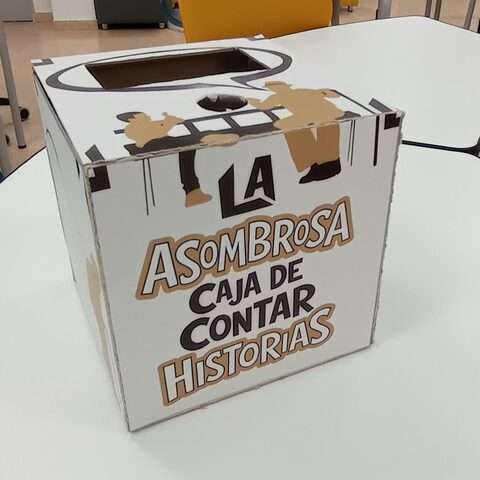
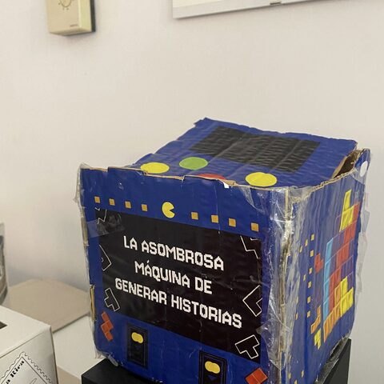
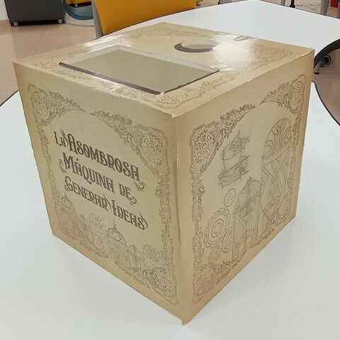
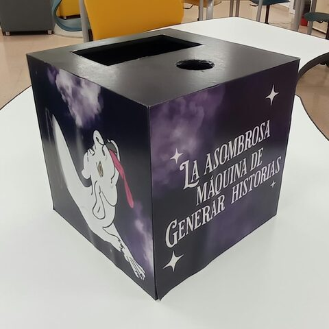
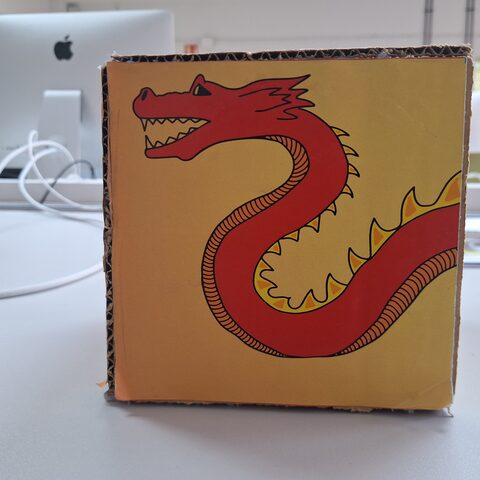
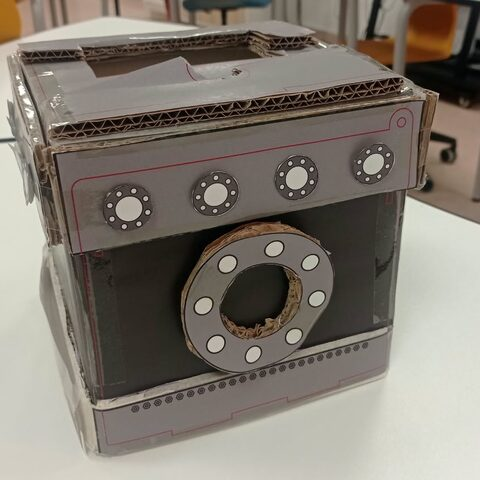
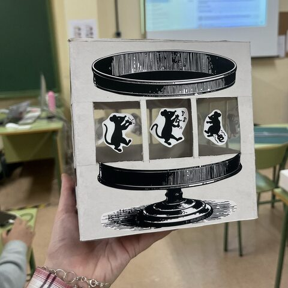

# Artes gráficas

Diseños para la caja de cartón de la máquina: troqueles, ilustraciones y
prototipos. Son obra del alumnado y el profesorado del módulo Diseño
Estructural de Envases y Embalajes, de 2.º curso de Grado Superior de Artes
Gráficas, del **IES Pilar Lorengar** (Zaragoza).

Hay seis modelos, cada uno con su propia estética. Cualquiera de ellos sirve
para vestir la misma máquina.

---

## Muestrario

Prototipos ya montados. Pulsa una foto para verla a tamaño completo.

| Alicia | Arcade | Steampunk |
|:-:|:-:|:-:|
|  |  |  |
| **Historia interminable · 1** | **Historia interminable · 2** | **Jules Verne** |
|  |  |  |
| **Zootropo** | | |
|  | | |

---

## Estructura

| Carpeta | Contenido |
|---|---|
| `00 troqueles y desarrollos/` | Troqueles base de la caja de cartón, comunes a varios modelos: con ventanas, continuos y el del zootropo |
| `01 fuentes/` | Ficheros editables de Illustrator (`.ai`) |
| `02 producción/` | PDF listos para imprimir |
| `03 mockups y prototipos/` | Fotos de los prototipos montados, en cartón y en resina, y algún mockup digital |

Dentro de `01`, `02` y `03`, cada subcarpeta lleva el número de su modelo.

---

## Modelos

| | Modelo | Estética | Estado |
|---|---|---|---|
| 00 | **Alicia** | Siluetas en blanco y negro de *Alicia en el país de las maravillas* | ✅ |
| 01 | **Arcade** | Máquina recreativa en *pixel art*: pantalla, botones y guiños a videojuegos clásicos | ✅ |
| 02 | **Steampunk** | Tres variantes sobre pergamino envejecido: dos con engranajes, ojos de buey y reloj, y una con una ciudad y dirigibles dibujados a tinta | ✅ |
| 03 | **Historia interminable** | Dos variantes: dragón blanco sobre cielo nocturno, y dragón rojo con cohete y astronauta | ✅ |
| 04 | **Jules Verne** | Paneles metálicos remachados y ojo de buey | ✅ |
| 05 | **Zootropo** | La caja como zootropo, con ratones en silueta que bailan al girar | ✅ |

---

## Qué imprimir

Los PDF de `02 producción/` son los que van a la impresora. Hay de dos tipos:

- **Desarrollo completo:** la caja entera en un solo pliego, con la línea de
  troquel. Mide entre 75 y 98 cm, así que pide un plóter o una copistería.
- **Caras sueltas:** una cara por página, en A4 o A3, para imprimir en el
  centro y pegar sobre el troquel de cartón.

| Modelo | Fichero | Formato |
|---|---|---|
| Alicia | `00_troquel_máquina_de_generar_ideas_cartón.pdf` | 80 × 60 cm |
| | `01_ilustraciones.pdf` | A3 |
| | `02_prototipo.pdf` | 6 págs. A4 |
| Arcade | `00_desarrollo_completo.pdf` | 98 × 52 cm |
| | `00_desarrollo_completo_continuo.pdf` | 75 × 55 cm |
| | `01_caras_sueltas.pdf` | 6 págs. A4 |
| Steampunk | `00_desarrollo_completo.pdf` | 84 × 61 cm |
| | `01_caras_sueltas_modelo1.pdf` | 6 págs. 30 × 30 cm |
| | `01_caras_sueltas_modelo2.pdf` | 6 págs. de unos 20 × 20 cm |
| | `01_caras_sueltas_modelo3.pdf` | 6 págs. de unos 20 × 20 cm, con línea de troquel |
| Historia interminable | `00_desarrollo_completo_modelo1.pdf` | 76 × 63 cm |
| | `00_desarrollo_completo_modelo2.pdf` | 76 × 63 cm |
| | `01_caras_sueltas_modelo2.pdf` | 3 págs. A3 |
| Jules Verne | `00_caras_sueltas.pdf` | 1 pág. 77 × 53 cm + 10 págs. A4 |
| | `00_caras_sueltas_prototipo.pdf` | 77 × 53 cm |
| Zootropo | `00_stencil_zootropo.pdf` | A4 |
| | `01_ratones_zootropo.pdf` | A4 |

Los PDF están en CMYK.

---

## Editar los diseños

Los `.ai` de `01 fuentes/` se guardaron compatibles con PDF. Así se abren
también en programas libres como **Inkscape**, aunque la edición completa,
con capas y efectos, pide Illustrator.

---

## Licencia

La obra original de este directorio se publica bajo
**Creative Commons Atribución-CompartirIgual 4.0 Internacional**
([`CC-BY-SA-4.0`](LICENSE)). Puedes usarla, modificarla y redistribuirla,
también con fines comerciales, siempre que cites la autoría y compartas lo
que derives con la misma licencia.

Atribución sugerida:

> Diseño: alumnado y profesorado de Artes Gráficas del IES Pilar Lorengar,
> para *La asombrosa máquina de generar historias* (Asociación Atrapavientos).
> CC BY-SA 4.0.

### Elementos de terceros

Estos diseños son ejercicios de alumnado de Formación Profesional, hechos para
un proyecto educativo y sin ánimo de lucro. Algunos rinden homenaje a obras
ajenas y contienen elementos que **no son nuestros y que la licencia CC BY-SA
no cubre**:

| Modelo | Elementos | Titulares |
|---|---|---|
| Arcade | Pac-Man y sus fantasmas | Bandai Namco Entertainment |
| Arcade | Piezas de Tetris | The Tetris Company |
| Arcade | Escenario de *Super Mario Bros.*: escalera de bloques, tubería y mástil | Nintendo |
| Historia interminable, modelo 1 | Fújur, el dragón de la suerte de *La historia interminable* | Herederos de Michael Ende |

Los nombres, personajes y marcas pertenecen a sus titulares. Se incluyen solo
como parte de un trabajo de aula, sin relación con ellos y sin que nadie
obtenga beneficio. Si reutilizas estos modelos, ten en cuenta que esos
elementos no están incluidos en la licencia.

**Si eres titular de alguno de estos derechos y prefieres que lo retiremos**,
abre una [incidencia](https://codeberg.org/atrapavientos/storymaker/issues) y
lo haremos.

Las siluetas del modelo Alicia se inspiran en las ilustraciones de John
Tenniel para la primera edición del libro (1865), de dominio público.
