# Manual de despliegue e instalación

Cómo pasar de una Raspberry Pi y una tarjeta SD en blanco a una máquina de
generar historias funcionando.

> **En cinco minutos.** Si la máquina ya está montada y solo quieres ponerla
> en marcha:
>
> 1. Descarga la imagen de la sección **Releases** ([2.1](#21-descargar-la-imagen)).
> 2. Grábala en la tarjeta con Raspberry Pi Imager ([2.3](#23-grabar-la-tarjeta)).
> 3. Enchufa la Pi, espera dos minutos y conecta el móvil a la WiFi
>    `StoryMaker-Setup` ([2.5](#25-conectarse-al-dispositivo)).
> 4. Elige la red de tu centro en la página que se abre ([2.6](#26-elegir-la-red-wifi-del-centro)).
> 5. Entra en `http://storymaker.local:5000` con el PIN que muestra la propia
>    página y completa el asistente ([2.7](#27-entrar-al-panel-de-control) y [2.8](#28-asistente-de-configuración-inicial)).
>
> Eso es la Ruta A entera. Lo de abajo es lo mismo, con capturas y con qué
> hacer cuando algo no sale.

Hay **dos caminos**, y conviene elegir antes de empezar:

| | **Ruta A — desde la imagen publicada** | **Ruta B — desde cero** |
|---|---|---|
| Para quién | Centros educativos, talleres, cualquiera que quiera un aparato funcionando | Quien quiera modificar el programa o reconstruir la imagen desde el código |
| Qué hace falta | Un ordenador con Raspberry Pi Imager y un móvil | Linux, terminal, SSH y algo de paciencia |
| Cuánto tarda | 15–20 minutos, casi todo esperando | 45–60 minutos |
| Conocimientos | Ninguno | Soltura con la línea de órdenes |

Si sólo quieres usar el dispositivo, **Ruta A**: no hay que instalar nada a
mano ni saber programar. La Ruta B existe porque el proyecto es libre y la
imagen tiene que poder reconstruirse desde el código.

Si la máquina ya está montada, sáltate el apartado 1 y ve directo a la
[Ruta A](#2-ruta-a--instalar-desde-la-imagen-publicada).

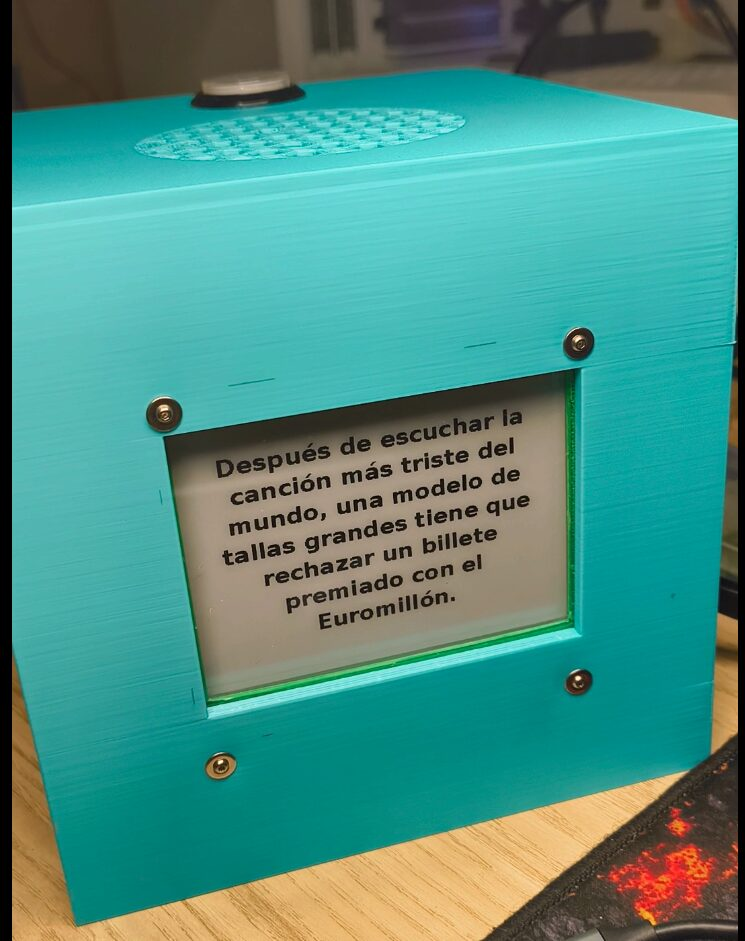

---

## 1. Material necesario

### Electrónica

| Componente | Notas |
|---|---|
| Raspberry Pi Zero 2W | **No** sirve la Zero 1: hace falta el 64-bit |
| Tarjeta microSD de 8 GB o más | Clase 10 o mejor |
| Alimentación 5 V / 2,5 A | Por micro-USB |
| Pantalla e-ink WeAct 4.2" B&N (SSD1683) | Opcional |
| Impresora térmica QR701 UART o QR204 TTL | Opcional. La QR204 se conecta por TTL, no por USB |
| Amplificador I2S MAX98357A + altavoz | Opcional |
| Pulsador momentáneo | Botón de generar |
| LED + resistencia | Indicador de estado |
| Condensador 1000 µF low-ESR (105 °C, 10 V) | **Muy recomendable**: evita reinicios en los picos de corriente |

Las tres salidas son opcionales e independientes. El aparato arranca y funciona
con cualquier combinación, incluida ninguna (en ese caso sólo responde por el
portal web).

**Alternativa solo con voz:** una Raspberry Pi 3 con el **Voice HAT de Google**
(kit AIY V1), que trae botón, LED y amplificador, sin la placa del proyecto ni
soldaduras. Sin pantalla ni impresora, la caja dice en voz alta a qué red
conectarse y en qué dirección está su panel. Se elige en el asistente (2.8);
pines y detalles en [`docs/hardware.md`](../hardware.md).

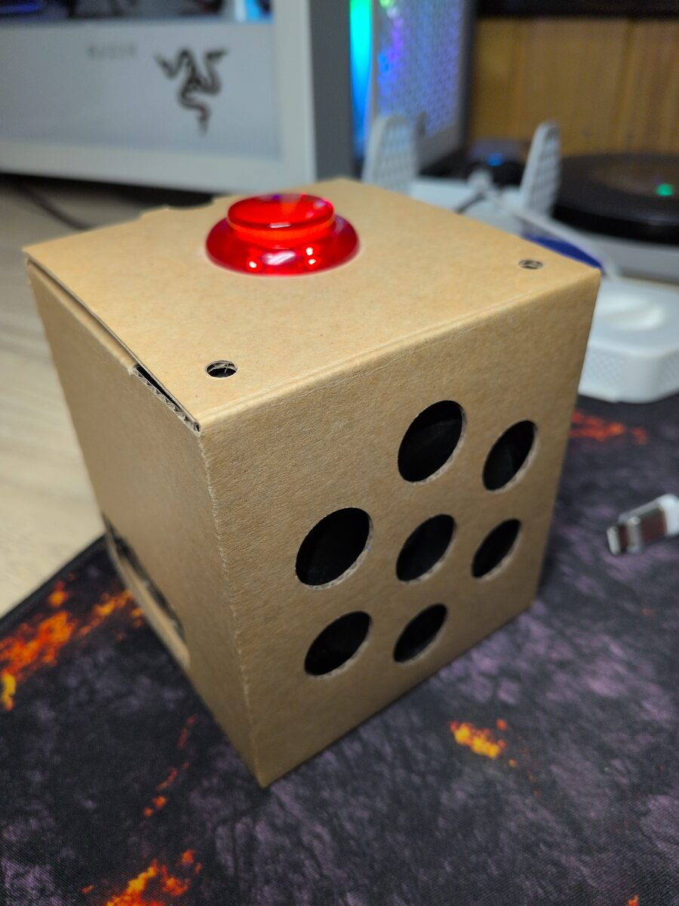

### Conexiones

Con la placa base del proyecto no hay que mirar pines: cada periférico va a
su conector, rotulado en la serigrafía. Qué se conecta en cada uno, en
[Conectores](../../hardware/README.md#conectores); ahí están también los
GPIO de la Raspberry Pi, por si montas sin la placa.

La impresora térmica **necesita alimentación aparte de la Pi**: con la placa,
va por su conector `PRINTER`; sin ella, directa a los 5 V de la fuente.


### Software en tu ordenador

- **Ruta A:** [Raspberry Pi Imager](https://www.raspberrypi.com/software/).
- **Ruta B:** además, Linux con `bash`, `ssh`, `rsync` y `openssl`.

---

## 2. Ruta A — Instalar desde la imagen publicada

### 2.1 Descargar la imagen

Ve a la sección **Releases** de este repositorio en Codeberg, abre la versión
más reciente (`vX.Y`, por ejemplo `v1.0`) y descarga los dos ficheros:

- `storymaker-vX.Y.img.xz` — la imagen (alrededor de 1 GB)
- `storymaker-vX.Y.img.xz.sha256` — su huella

Si la release lleva además algún `storymaker-actualizacion-….tar`, no lo
necesitas para instalar: la máquina lo ofrecerá ella misma desde el panel
(sección 4).

**Codeberg es el único sitio de descarga.** Si algún día este repositorio se
replica en otra forja, la imagen se seguirá bajando de aquí: los espejos de git
copian el código y los tags, no los adjuntos de las releases.

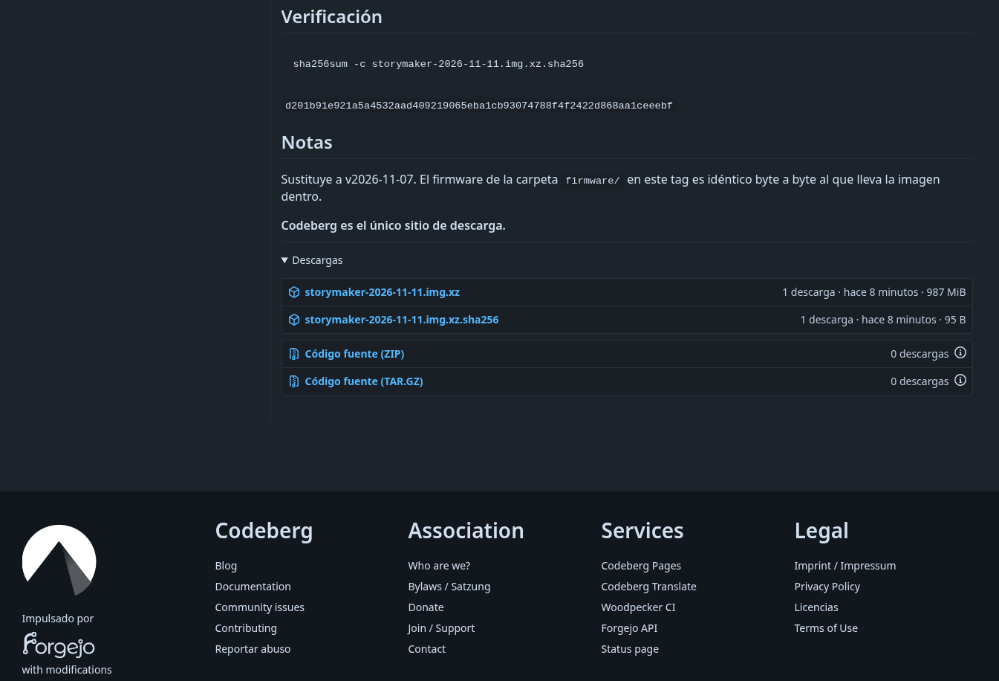

### 2.2 Comprobar que la descarga está íntegra

En la carpeta donde hayas dejado los dos ficheros:

```bash
sha256sum -c storymaker-vX.Y.img.xz.sha256
```

Debe responder `: La suma coincide` (o `: OK`). Si no coincide, **no sigas**:
la descarga está corrupta o incompleta. Bórrala y repítela.

En Windows, desde PowerShell:

```powershell
Get-FileHash storymaker-vX.Y.img.xz -Algorithm SHA256
```

y compara a ojo el resultado con el contenido del fichero `.sha256`.

### 2.3 Grabar la tarjeta

No hace falta descomprimir el `.xz`: el Imager lo hace solo.

1. Abre Raspberry Pi Imager.
2. **Dispositivo** → *Raspberry Pi Zero 2 W*.
3. **Sistema operativo** → baja hasta el final → **"Usar imagen personalizada"**
   → selecciona el `.img.xz` descargado.
4. **Almacenamiento** → tu tarjeta microSD. Mira dos veces que es la tarjeta y
   no un disco externo: se borra entera.
5. **Siguiente** → **Escribir**. El paso *Personalización* aparece en gris y
   el Imager se lo salta: con una imagen personalizada no se puede usar, y no
   hace falta, porque la imagen ya trae su configuración.
6. Espera a que grabe y verifique (5–10 minutos).

> Con versiones antiguas del Imager (la 1.x) sí sale una pregunta sobre
> personalizar los ajustes. Responde **NO**: personalizarla rompe la imagen.

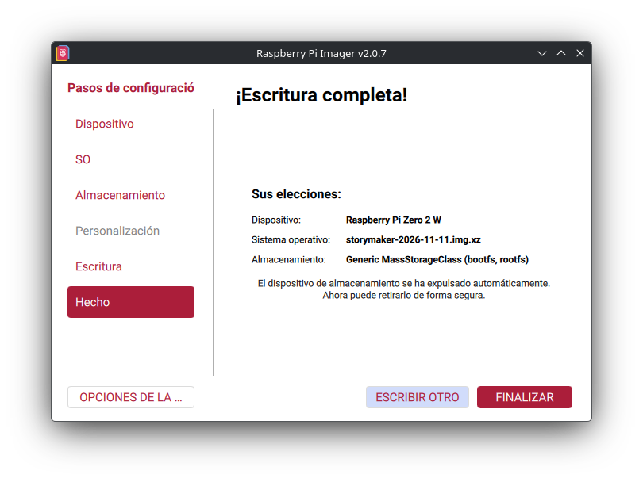

### 2.4 Primer arranque

Mete la tarjeta en la Pi y conéctala a la corriente.

El primer arranque **tarda unos dos minutos**: el sistema expande la partición
para ocupar toda la tarjeta y se reinicia una vez. Es normal que parezca que no
pasa nada. No la desenchufes.

Cuando esté lista:

- El **LED de estado** se queda fijo encendido.
- Si hay **pantalla e-ink**, muestra la pantalla de bienvenida con un código QR
  para configurar la WiFi.
- Si hay **impresora**, imprime un tique con el nombre de la red a la que
  conectarte y ese mismo QR.
- Si hay **altavoz**, dice en voz alta a qué red conectarte.

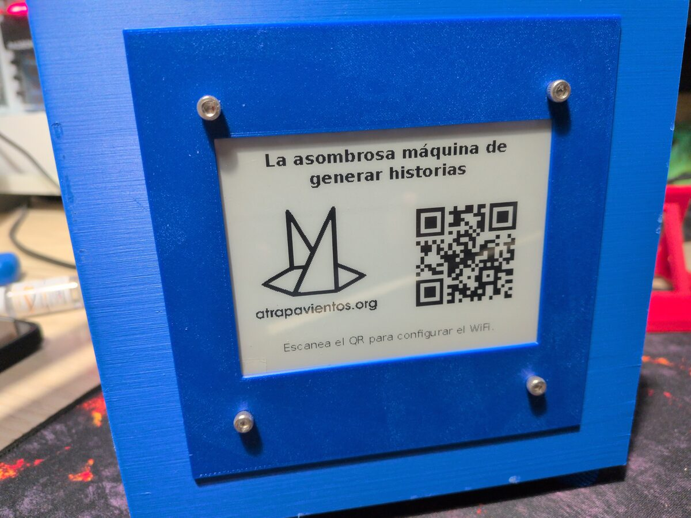
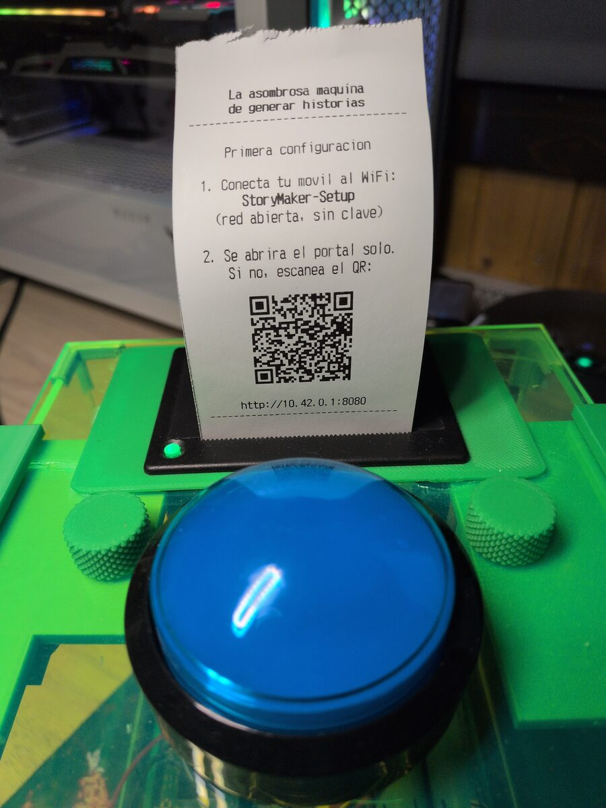

Con el **Voice HAT** en una Raspberry Pi 3, la caja reconoce el HAT y se
reinicia una vez más para cargar su driver de audio: cuenta con un minuto
extra antes de oír el aviso.

### 2.5 Conectarse al dispositivo

Como todavía no conoce ninguna red, la máquina levanta su propia WiFi.

1. En el móvil o el portátil, abre la lista de redes WiFi y conéctate a
   **`StoryMaker-Setup`**. No tiene contraseña.
2. El navegador debería abrirse solo con la página de configuración. Si no lo
   hace, escribe a mano `http://10.42.0.1`.
3. El móvil avisará de que "esta red no tiene acceso a internet". Es correcto:
   dile que la mantenga conectada.

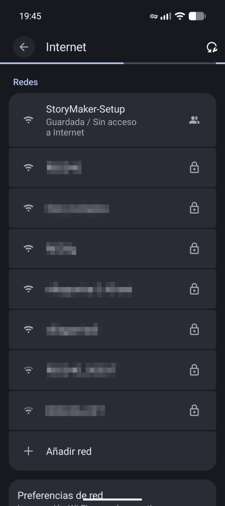

### 2.6 Elegir la red WiFi del centro

La página de configuración muestra las redes que la máquina ve a su alrededor.

1. Toca la tuya en la lista.
2. Escribe la contraseña. El icono del ojo deja comprobar que la has tecleado
   bien, que es donde falla casi siempre.
3. **Conectar →**

La pantalla pasa a *Conectando...*. Si la contraseña era incorrecta o la red no
responde, al cabo de unos segundos vuelve al formulario con un aviso en rojo y
la red ya seleccionada, lista para reintentar.

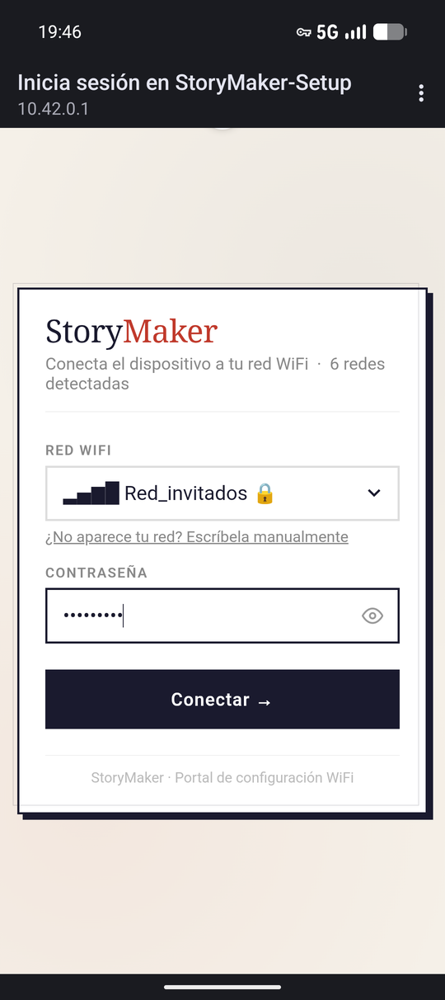

Si va bien, la máquina apaga su red `StoryMaker-Setup` para conectarse a la
tuya, así que **lo normal es que la página del móvil se cierre sola** sin
llegar a mostrar ningún mensaje de éxito. No es un fallo: el aviso lo da la
propia máquina, que en unos segundos anuncia su nueva dirección:

- En la **pantalla e-ink**, con un QR que lleva al panel de control.
- En un **tique**, con la dirección numérica (`http://192.168.x.x:5000`), la
  alternativa **`http://storymaker.local:5000`** y el mismo QR.
- Por el **altavoz**, dictando la dirección.

Apunta la dirección numérica: es la que funciona en cualquier red.

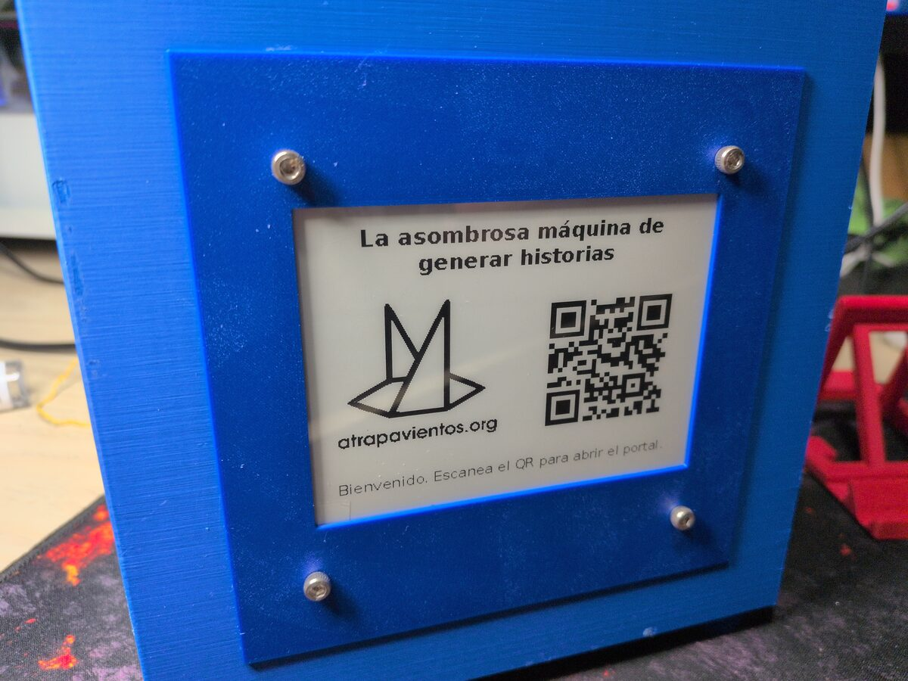
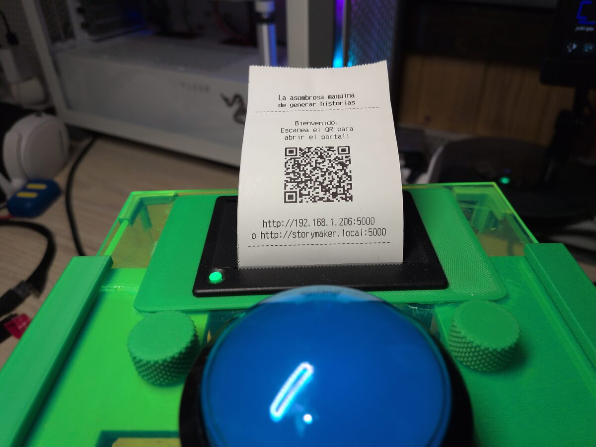

### 2.7 Entrar al panel de control

1. Vuelve a conectar el móvil o el portátil a **la WiFi normal del centro** (la
   misma a la que acabas de conectar la máquina).
2. Escanea el QR o abre `http://storymaker.local:5000`.

Si el navegador no encuentra esa dirección, es que la red del centro no resuelve
nombres `.local`. Entra por la dirección numérica que te ha dado la máquina,
`http://<ip>:5000`. Pasa sobre todo en redes con aislamiento de clientes.

La pantalla de acceso pide un PIN. **En el primer arranque, la propia página
muestra arriba cuál es el PIN inicial** y avisa de que podrás cambiarlo en el
paso siguiente.

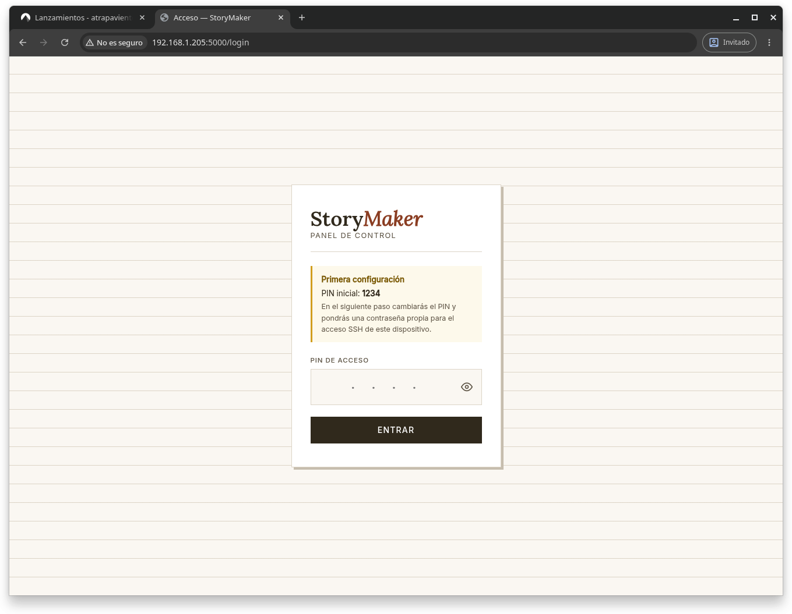

### 2.8 Asistente de configuración inicial

Al entrar por primera vez, el panel lleva directo al asistente. Tiene estos
bloques:

**Placa** — *StoryMaker (PCB del proyecto)* o *Voice HAT de Google con
Raspberry Pi 3*, la alternativa solo con voz (ver `docs/hardware.md`). Si la
caja ha reconocido el Voice HAT, ya viene marcado. Cambiar de placa reinicia la
caja.

**Pantalla e-ink** — actívala si la tienes conectada.

**Impresora térmica** — actívala si la tienes. El *baudrate* por defecto (9600)
vale para la QR701 y la QR204; cámbialo sólo si tu modelo pide otro.

**Altavoz I2S** — actívalo si lo tienes, y ajusta el volumen con el deslizador.

**PIN de acceso al portal** — opcional. De 4 a 8 dígitos. Si lo dejas vacío, se
queda como está.

**Contraseña del dispositivo** — **obligatoria.** La imagen es pública y
todas las máquinas grabadas con ella arrancan con la misma contraseña; quien
la conozca y esté en tu red podría entrar al aparato y leer la clave WiFi del
centro. Mínimo 6 caracteres, sin espacios. Apúntala: solo la necesitarás si
algún día entras por SSH, pero no se puede recuperar sin volver a grabar la
tarjeta. El detalle, en [`docs/sistema.md`](../sistema.md#acceso-y-credenciales).

Pulsa el botón de guardar. El servicio se reinicia solo y te deja en el panel.


### 2.9 Comprobar que todo funciona

En el panel, pulsa **GENERAR**. Debería ocurrir todo esto, según lo que tengas
activado:

- El LED parpadea dos veces y vuelve a quedarse fijo.
- La e-ink muestra la animación de la pluma y después la premisa.
- La impresora saca el tique.
- El altavoz lee la frase en voz alta.

Ahora prueba el **botón físico**: una pulsación corta hace exactamente lo mismo.

Si algo no responde, vuelve al asistente (**⚙ Hardware** en la cabecera) y
comprueba que esa salida está activada. Si lo está, mira la sección de
problemas al final.

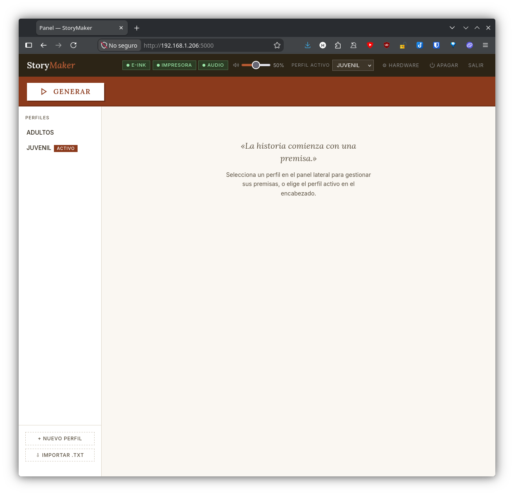

Con esto el dispositivo está listo. Para usarlo en el taller, sigue con el
[manual de usuario](usuario.md).

---

## 3. Ruta B — Instalar desde cero

Esta ruta parte de un Raspberry Pi OS limpio y aplica la instalación completa.
Es la que usa quien desarrolla el firmware, y la que permite reconstruir la
imagen publicada desde el código.

Todo lo que sigue se ejecuta desde una copia de este repositorio en tu
ordenador:

```bash
git clone https://codeberg.org/atrapavientos/storymaker.git
cd storymaker
```

### 3.1 Grabar Raspberry Pi OS Lite

Con Raspberry Pi Imager:

- **Dispositivo:** Raspberry Pi Zero 2 W
- **Sistema operativo:** Raspberry Pi OS **Lite (64-bit)**, versión **Bookworm**
- **Personalización: NO.**

> **Bookworm, no Trixie.** El firmware usa `RPi.GPIO` con polling por software,
> que en Debian 13 está obsoleto y no funciona. Si el Imager sólo te ofrece una
> versión más nueva, busca Bookworm en el apartado de versiones anteriores.

No personalices desde el Imager: con Bookworm trata la imagen como una Debian
genérica y la personalización no se aplica bien. De eso se encarga el paso
siguiente.

### 3.2 Preparar la tarjeta desde el PC

Con la tarjeta todavía en el lector, identifica el dispositivo:

```bash
lsblk -o NAME,SIZE,LABEL,MOUNTPOINT | grep -v loop
```

Busca el que tenga el tamaño de tu tarjeta y dos particiones (`bootfs` y
`rootfs`). Anota su nombre, por ejemplo `/dev/sdb`. **Sin número de partición.**

```bash
sudo firmware/deploy/prepare_sd.sh /dev/sdX "NombreDeTuWiFi" "ContraseñaDeTuWiFi"
```

El script muestra un resumen y pide confirmación antes de tocar nada. Después
te pide **dos veces** la contraseña que quieres para el usuario `storymaker` en
la Pi (no se ve al teclear) y la guarda ya cifrada.

Deja configurados: el usuario, el nombre de máquina, el acceso SSH y el perfil
de red WiFi.

Para una red abierta, pasa la contraseña vacía: `"MiRed" ""`.

### 3.3 Primer arranque y acceso por SSH

Mete la tarjeta en la Pi y enciéndela. Conecta sola a la WiFi que configuraste.
Al cabo de un minuto:

```bash
ssh storymaker@storymaker.local
# o, si mDNS no resuelve, con la IP que veas en el router:
ssh storymaker@192.168.1.XX
```

**Espera dos o tres minutos más antes de seguir.** Al primer arranque,
`unattended-upgrades` se queda con el bloqueo de `apt`, y el paso siguiente
falla si lo pillas trabajando.

### 3.4 Instalación automática

`setup_sd.sh` se conecta con clave SSH. Si no tienes una para esto, créala:

```bash
ssh-keygen -t ed25519 -f ~/.ssh/storymaker_dev
```

Y lanza la instalación con la IP de la Pi:

```bash
cd firmware/deploy
./setup_sd.sh 192.168.1.XX
# con otra clave:
./setup_sd.sh 192.168.1.XX ~/.ssh/mi_clave.pub
```

Son nueve pasos y **tarda bastante** (el `apt upgrade` es el grueso). Te pedirá
la contraseña del usuario `storymaker` una sola vez, en el paso 0, para
instalar la clave; a partir de ahí va solo:

| Paso | Qué hace |
|---|---|
| 0/8 | Instala tu clave SSH |
| 1/8 | Paquetes del sistema |
| 2/8 | Habilita SPI, UART e I2S; configura `journald` |
| 3/8 | Red y perfil del punto de acceso |
| 4/8 | `iptables` para el portal cautivo |
| 5/8 | ALSA (`dmix`) para el amplificador I2S |
| 6/8 | Servicios systemd, `sudoers` y scripts del sistema |
| 7/8 | Entorno virtual de Python |
| 8/8 | Despliega el firmware, la configuración y los perfiles |

Al final imprime una lista de comprobaciones y reinicia la Pi.

### 3.5 Comprobar

Un minuto después del reinicio, abre `http://storymaker.local:5000` y sigue
desde el [paso 2.7](#27-entrar-al-panel-de-control): la pantalla de acceso y el
asistente son los mismos.

---

## 4. Actualizar un dispositivo ya instalado

Las versiones se numeran `vX.Y.Z`. Cambia el tercer número (`v1.0` →
`v1.0.1`) en una **actualización**, y el primero o el segundo (`v1.0` →
`v1.1`) en una **imagen nueva**.

**Actualizaciones (`v1.0.1`, `v1.0.2`…), con cualquiera de las dos rutas:**
desde el panel, en **⟳ Actualizar**. Conservan perfiles, premisas y
configuración, y la máquina vuelve sola a la versión anterior si la nueva no
arranca. Van firmadas por el proyecto. Detalles para quien la usa en el
[manual de usuario](usuario.md), 10. Las máquinas con una imagen anterior a la
`v1.0` no tienen esta opción: hay que grabarles la `v1.0` una vez.

**Imagen nueva (`v1.1`…), con la Ruta A:** grabar la imagen en la tarjeta, como
la primera vez. Se pierden los perfiles que hayas escrito en la máquina: copia
antes tus listas a un `.txt` para volver a importarlas (ver el [manual de
usuario](usuario.md), 8). El panel avisa cuando hay una.

**Desde el código** (Ruta B), se actualiza conservando la configuración y los
perfiles:

```bash
cd firmware/deploy
./deploy.sh 192.168.1.XX
```

**Conserva** `config.json` y `data/perfiles/`: no pierdes ni la configuración de
hardware ni las premisas que hayas escrito en el dispositivo. Además actualiza
`edge-tts`, la voz principal, que deja de funcionar cuando Microsoft cambia su
protocolo.

Si el dispositivo viene de una imagen anterior a `v2026-11-07`, su perfil de
serie `1eso` se renombra solo a `juvenil` al arrancar, con sus premisas.

Pedirá la contraseña del dispositivo al instalar los ficheros de sistema. Si
sólo has tocado código Python, puedes saltarte ese paso:

```bash
./deploy.sh --solo-firmware 192.168.1.XX
```

Para saber si te vale la versión corta, mira si han cambiado los ficheros de
sistema desde la última vez:

```bash
git diff --name-only <versión-anterior>..HEAD -- firmware/deploy/sistema/
```

Si no sale nada, `--solo-firmware` es suficiente.

---

## 5. Problemas frecuentes

**El LED no se enciende nunca y no aparece la red `StoryMaker-Setup`.**
La tarjeta no arrancó. Vuelve a grabarla y comprueba la huella SHA256 del
fichero descargado. Si se repite, prueba otra tarjeta: las microSD baratas
fallan mucho.

**Aparece `StoryMaker-Setup` aunque ya configuré la WiFi.**
La máquina no encontró la red que conoce. Puede ser que haya cambiado la
contraseña del centro, que esté fuera de cobertura o que el router esté en
5 GHz: la Pi Zero 2W **sólo habla 2,4 GHz**. Conéctate al punto de acceso y
vuelve a configurar la red.

**`storymaker.local` no resuelve.**
La red del centro no pasa mDNS, cosa habitual con aislamiento de clientes.
Entra por la dirección numérica, `http://<ip>:5000`. La máquina la anuncia al
arrancar (en la e-ink, en el tique y por voz); si no tienes ninguna de esas
salidas, búscala en el router.

**La e-ink se queda en blanco o con la imagen anterior.**
Esta pantalla **no admite refresco parcial**; cada actualización es un refresco
completo y tarda unos segundos. Si pasa de diez segundos, revisa las
conexiones DC, RST y BUSY, que son las que suelen estar flojas.

**La impresora imprime caracteres raros o nada.**
Baudrate incorrecto, o el UART ocupado por la consola serie. En una instalación
hecha con `setup_sd.sh` la consola ya está desactivada; si instalaste a mano,
revísalo.

**El audio chasquea entre premisas.**
Falta la configuración `dmix` en `/etc/asound.conf`. La instala `setup_sd.sh`.

**Sin internet, la voz suena robótica.**
La voz principal (`edge-tts`) es un servicio en línea. Si la caja no llega a
él, pasa en dos segundos a la voz local, de peor calidad, y durante dos minutos
no vuelve a intentarlo. Es el comportamiento previsto. Si **con** internet
tampoco suena la voz buena, mira el registro
(`journalctl -u historias.service -n 50`): un error 403 significa que hay que
actualizar `edge-tts` (lo hace `deploy.sh`, sección 4).

**El dispositivo se reinicia solo al imprimir o al hablar.**
Pico de consumo. Es justo lo que resuelve el condensador de 1000 µF en la
alimentación. Revisa también que la fuente dé 2,5 A de verdad.

**Quiero cambiar la máquina de red WiFi.**
Enchufa la máquina **con el botón ya pulsado** y no lo sueltes: el botón se
lee unos 20–30 segundos después, justo antes de que se conecte a la WiFi. El
LED parpadea despacio mientras lo detecta y rápido cuando está confirmado:
suéltalo entonces. Funciona igual con la placa del proyecto y con el Voice HAT. La máquina levanta `StoryMaker-Setup` y puedes volver a configurarla
desde el [paso 2.5](#25-conectarse-al-dispositivo).

**Quiero empezar de cero sin volver a grabar la tarjeta.**
En **⚙ Hardware**, abajo del todo, **↺ Reset de fábrica**. Devuelve el
dispositivo al estado de primer arranque. **No borra las premisas ni los
perfiles.**

---

## 6. Dónde está cada cosa

- Qué queda instalado en el sistema operativo: [`../sistema.md`](../sistema.md)
- Pinout y periféricos: [`../hardware.md`](../hardware.md)
- Por qué el firmware está hecho así: [`../decisiones.md`](../decisiones.md)
- Generar una imagen distribuible nueva: [`../desarrollo.md`](../desarrollo.md)
- Cómo se usa en el taller: [`usuario.md`](usuario.md)
