# Manual de usuario

Para quien va a usar la máquina en un taller. No hace falta saber nada de
informática ni de electrónica.

Si todavía no la has instalado, empieza por el
[manual de despliegue](despliegue.md).

> **En cinco minutos.**
>
> - **Encender:** enchúfala y espera a que el LED se quede fijo, un minuto.
> - **Generar:** pulsa el botón. La premisa sale por la pantalla, el tique o
>   el altavoz, según lo que tenga la máquina.
> - **Apagar:** mantén el botón dos segundos y espera a que el LED se apague.
> - **Cambiar las frases o el perfil:** desde el móvil, en la misma WiFi, en
>   `http://storymaker.local:5000` ([punto 5](#5-el-panel-de-control)).
> - **Cuántas premisas da una sesión:** tantas como frases tenga la lista más
>   corta ([punto 9](#9-cuando-se-agotan-las-combinaciones)).
>
> El resto del manual es eso mismo con detalle, y lo que hacer cuando algo no
> va.

---

## 1. Qué hace la máquina

Cada vez que pulsas el botón, la máquina inventa una **premisa narrativa**:
el arranque de una historia que alguien tiene que continuar.

Las premisas se montan combinando tres listas:

```
<detonante>, <protagonista> <conflicto>
```

> *Después de ganar la lotería, una adolescente descarada ingresa en una
> milicia.*

Las tres listas forman un **perfil**. Cambiando de perfil cambia el tono de lo
que sale: no es lo mismo un taller juvenil que uno con adultos.

La premisa sale por donde tengas activado: la pantalla de tinta electrónica, la
impresora de tiques o el altavoz, que la lee en voz alta. Pueden ser las tres a
la vez.

---

## 2. Encender y apagar

**Encender:** enchúfala. Tarda alrededor de un minuto. Está lista cuando el
**LED se queda fijo encendido**.

**Apagar:** mantén el botón pulsado **dos segundos**. La máquina se despide por
las salidas que tengas activas y se apaga sola. El LED se apaga al terminar.
También puedes apagarla desde el panel de control, con **Apagar** en la
cabecera.

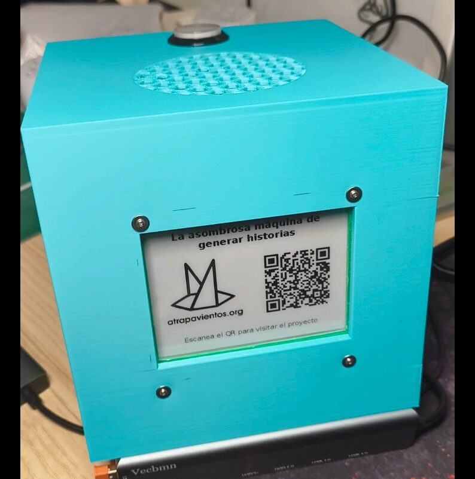

> **Espera a que el LED se apague antes de desenchufarla.** Cortar la corriente
> de golpe repetidas veces acaba corrompiendo la tarjeta de memoria. Si pasa,
> hay que volver a grabarla.

---

## 3. El botón y el LED

Todo lo que hace la máquina sin ordenador cabe en un botón.

| Acción | Qué ocurre |
|---|---|
| **Pulsación corta** | Genera una premisa y la envía a las salidas activas |
| **Pulsación de 2 segundos** | Apagado seguro |
| **Pulsar mientras arranca** (unos 3 s) | Fuerza el modo de configuración WiFi |

Y el LED te dice en qué está:

| LED | Significado |
|---|---|
| Fijo encendido | Lista, esperando |
| Dos parpadeos rápidos | Ha recibido la pulsación, está generando |
| Cinco parpadeos lentos | Se han agotado las combinaciones (ver [punto 9](#9-cuando-se-agotan-las-combinaciones)) |
| Parpadeo lento durante el arranque | Está detectando que mantienes el botón |
| Parpadeo rápido durante el arranque | Confirmado: ya puedes soltar |
| Apagado | Apagándose, o apagada |

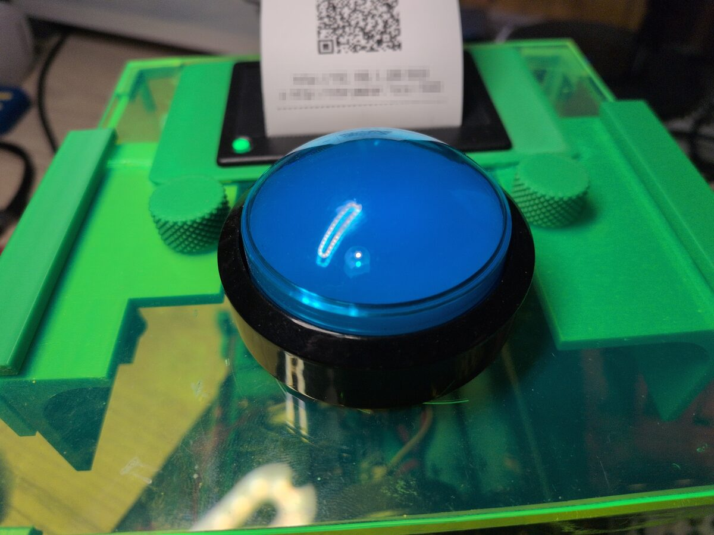

---

## 4. Generar premisas

Hay dos formas, y hacen exactamente lo mismo:

- **El botón físico.** Es la que se usa en el taller: el alumno pulsa y espera.
- **El botón GENERAR del panel de control**, desde el móvil o el ordenador.
  Útil para dirigir la sesión sin levantarte.

Lo que tarda depende de las salidas: la pantalla e-ink necesita unos segundos
para refrescarse entera, y la voz tarda lo que tarde en leer la frase.

**Con el panel de control abierto, la premisa aparece también en pantalla**, en
grande, venga del botón físico o del de GENERAR. Sirve para proyectarla en el
aula o leerla en voz alta. Se cierra con «Cerrar» o tocando fuera, y «Otra
premisa» genera la siguiente. Solo aparece mientras el panel está a la vista:
lo que se genere con el móvil bloqueado o en otra pestaña no salta al volver.

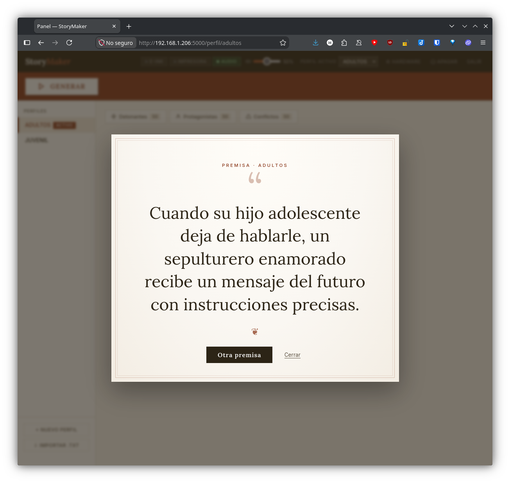 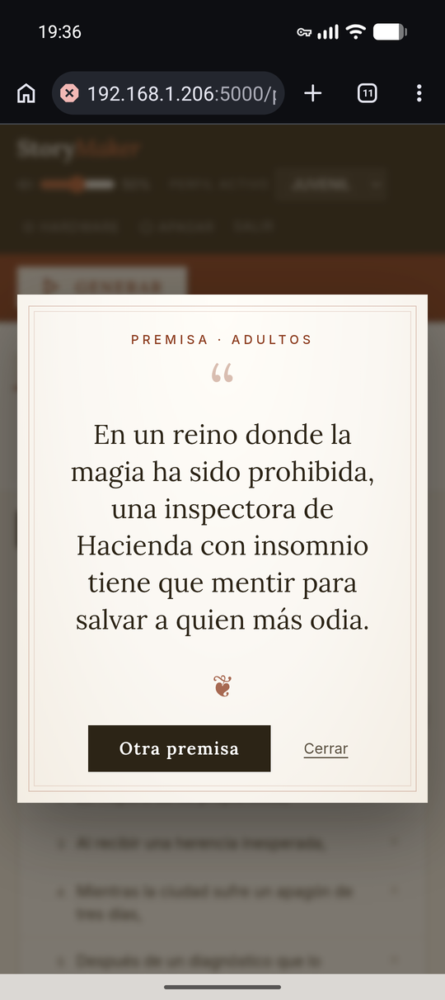

> **La pantalla e-ink se refresca entera cada vez.** Parpadea en blanco y negro
> durante un par de segundos antes de mostrar la premisa. No está rota: esta
> tecnología no admite refrescos parciales. Mientras tanto, muestra el dibujo
> de una pluma para que se note que está trabajando.

 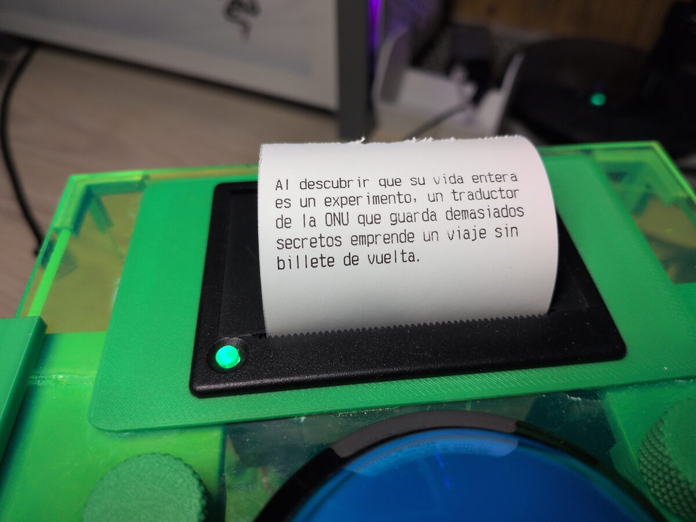

---

## 5. El panel de control

Todo lo que no es "pulsar el botón" se hace desde una página web que sirve la
propia máquina.

### Entrar

1. Conecta el móvil o el ordenador **a la misma WiFi que la máquina**.
2. Abre `http://storymaker.local:5000`.
3. Escribe el PIN.

Si esa dirección no funciona, es que la red del centro no resuelve nombres
`.local`. Pide al responsable de informática la IP del dispositivo y entra por
`http://<esa-ip>:5000`.

### Qué hay en la pantalla

- **Arriba:** las salidas activas, el deslizador de volumen (sólo si hay
  altavoz), el selector de **perfil activo**, el acceso a **⚙ Hardware**,
  **Apagar** y **Salir**.
- **La barra GENERAR**, a todo lo ancho.
- **A la izquierda:** la lista de perfiles y el botón de crear uno nuevo.
- **En el centro:** las premisas del perfil que estés mirando, por categorías.

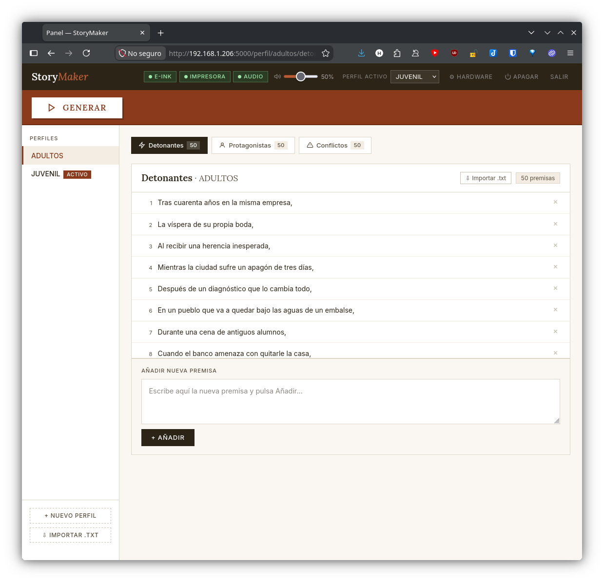 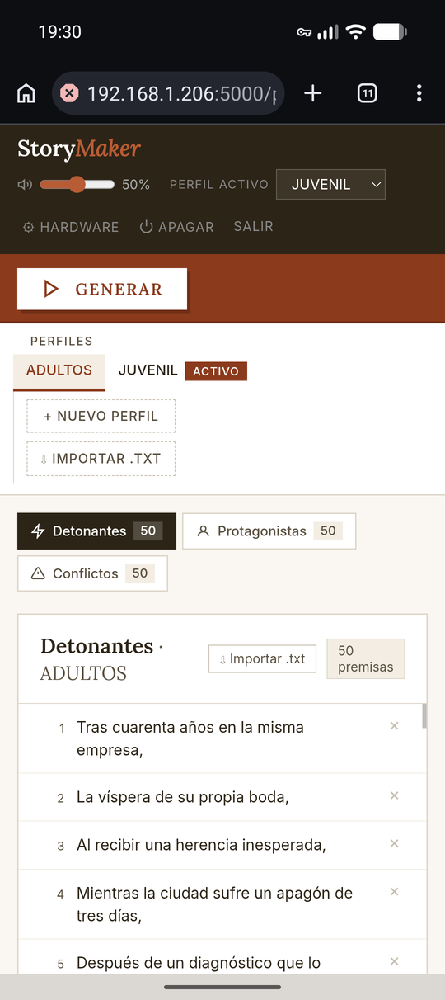

---

## 6. Perfiles

Un perfil son tres listas de frases pensadas para un público. El dispositivo
viene con dos de ejemplo, y puedes crear los que quieras.

**Cambiar el perfil activo:** el selector de la cabecera, arriba a la derecha.
El cambio es inmediato: la siguiente pulsación del botón ya usa el nuevo.

**Ver o editar un perfil:** pínchalo en la lista de la izquierda. Puedes mirar
y editar cualquiera sin cambiar el activo.

**Crear uno nuevo:** **+ Nuevo perfil** abajo a la izquierda. Nace vacío, y hay
que darle contenido antes de poder usarlo: **las tres categorías necesitan al
menos una frase**. Con una sola vacía, el perfil no funciona.


---

## 7. Escribir premisas

Pincha un perfil y después una de las tres categorías.

### Cómo se redacta cada una

Las tres frases se pegan tal cual, en este orden. De ahí las reglas:

| Categoría | Qué es | Cómo termina | Ejemplo |
|---|---|---|---|
| **Detonantes** | Cómo o cuándo arranca la historia | En coma | *Después de ganar la lotería,* |
| **Protagonistas** | Quién la protagoniza | Sin puntuación | *una adolescente descarada* |
| **Conflictos** | Qué le ocurre | En punto | *ingresa en una milicia.* |

El truco está en que **cualquier detonante tiene que encajar con cualquier
protagonista y cualquier conflicto**. Si escribes un detonante que sólo
funciona con un personaje concreto, la mayoría de las combinaciones saldrán
raras. Conviene leer en voz alta unas cuantas al azar antes de dar una lista
por buena.

El género también importa: *una adolescente descarada* obliga a que los
conflictos valgan en femenino. Mezclar géneros en la lista de protagonistas y
escribir los conflictos de forma neutra es lo que mejor funciona.

### Añadir y borrar

- **Añadir:** el campo del final de la lista, y **+ Añadir**.
- **Borrar:** la equis a la derecha de cada frase.

Los cambios se guardan al momento.

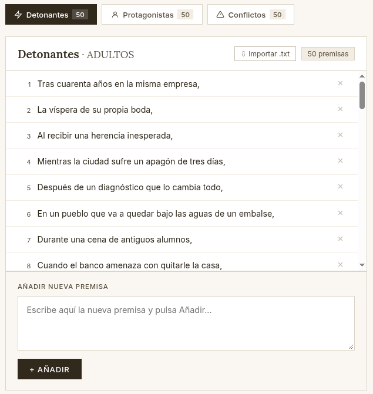

---

## 8. Importar listas desde un `.txt`

Escribir cien frases a mano en el móvil no es razonable. Si las tienes en un
documento, impórtalas de golpe con **⇪ Importar .txt**.

Son tres pasos y **no se escribe nada hasta que confirmas**.

**Paso 1 — Destino.** A qué perfil van. Puedes crear uno nuevo en el momento y
dejarlo como activo al terminar.

**Paso 2 — Modo.** *Añadir al final* (lo normal) o *reemplazar la lista*
entera. En un perfil nuevo no aplica.

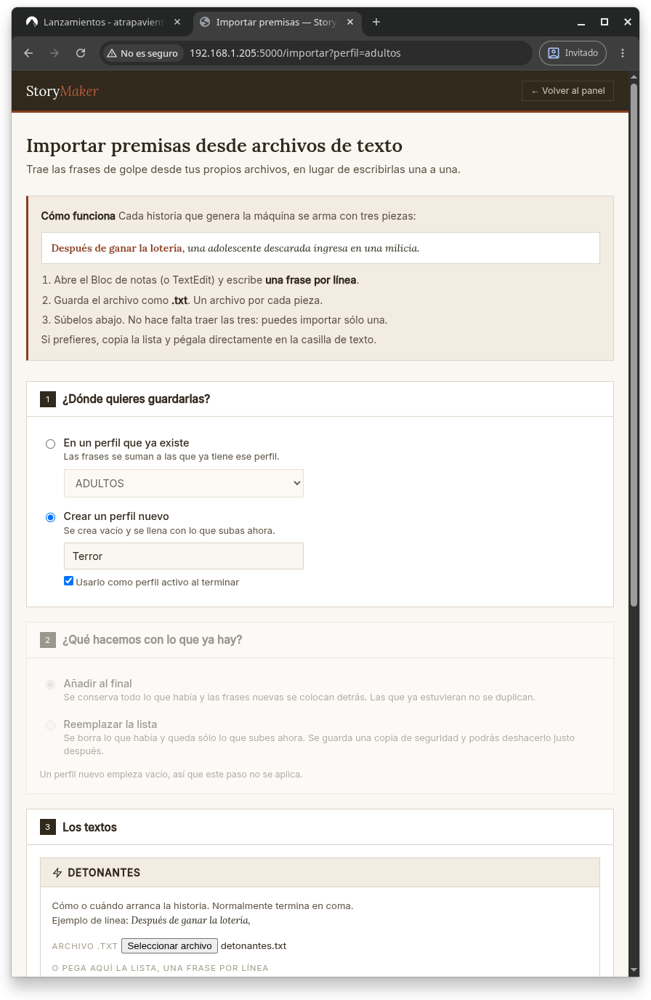

**Paso 3 — Textos.** Un fichero `.txt` por categoría, **una frase por línea**, o
pegado a mano en el recuadro. Si rellenas las dos cosas para la misma
categoría, se juntan. Las categorías que dejes vacías **no se tocan**, ni
siquiera en modo reemplazar.

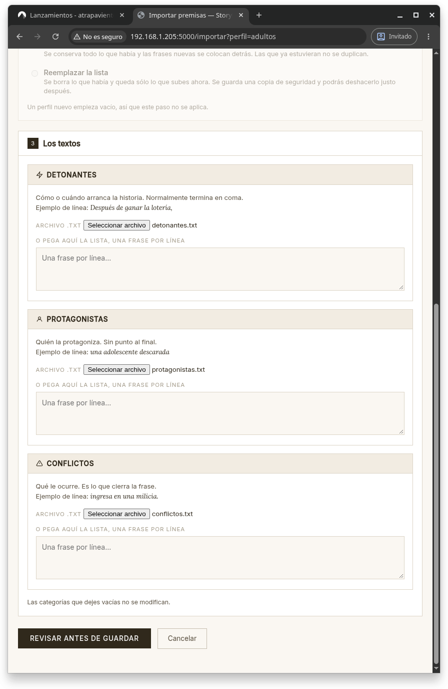

Después aparece una **revisión** antes de tocar nada: cuántas frases entran,
cuáles se descartan (repetidas, ya presentes, demasiado largas) y cómo queda
cada categoría. Si algo no cuadra, vuelve atrás.

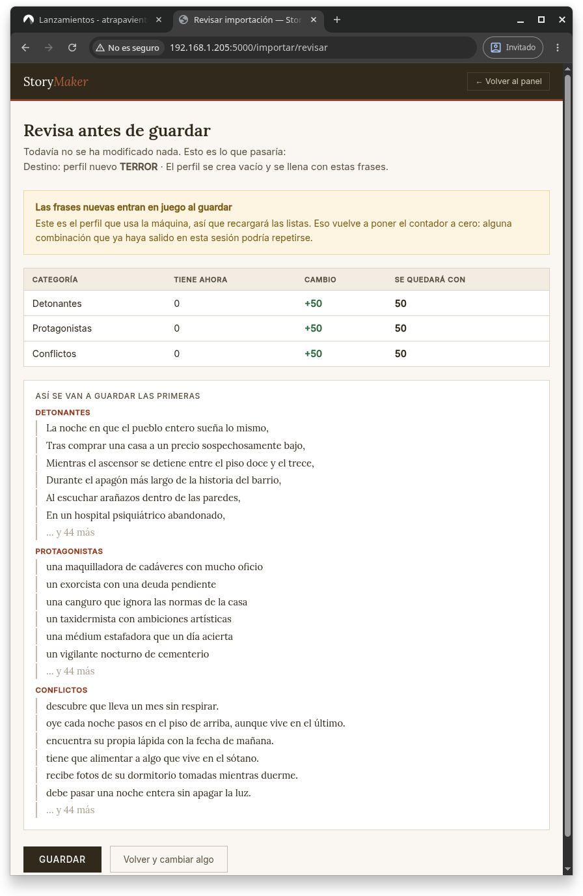

Al confirmar, el botón **Deshacer** devuelve las listas a como estaban. **Un
solo nivel:** la siguiente importación lo sustituye.

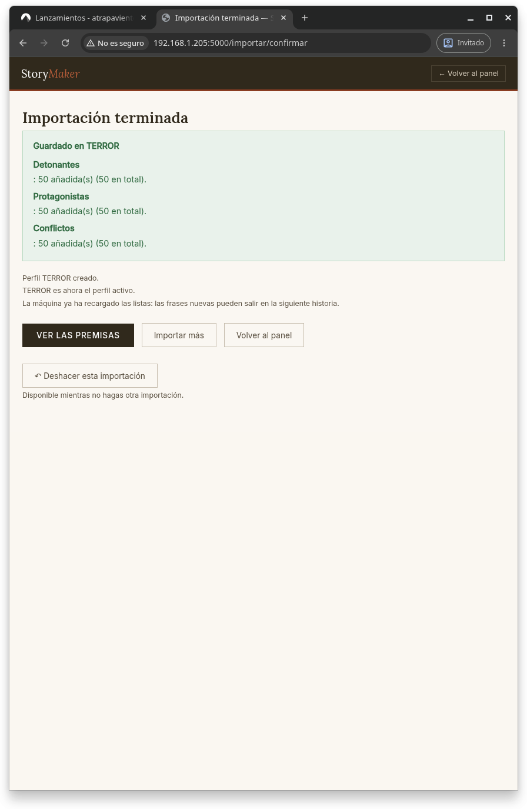

Los `.txt` de Word y del Bloc de notas de Windows funcionan sin tocar nada: el
importador se apaña con sus codificaciones.

**Límites:** 3 MB por envío, 5000 frases por categoría y 300 caracteres por
frase.

---

## 9. Cuando se agotan las combinaciones

**Las premisas no se repiten dentro de una misma sesión.** Cada frase que sale
se consume, de modo que nadie oye dos veces lo mismo.

Eso significa que el número de premisas de una sesión es **el de la categoría
más corta**. Con 40 detonantes, 25 protagonistas y 60 conflictos salen **25
premisas**, no 60.000. Si quieres una sesión más larga, el trabajo está en
engordar la lista más corta, no las tres.

Cuando se acaban, el LED da cinco parpadeos lentos y la máquina avisa por las
salidas activas.

Para volver a empezar, cualquiera de estas dos:

- **Reiniciar el dispositivo** (apagar con el botón y volver a enchufar).
- **Cambiar de perfil y volver al anterior** desde el panel. Más rápido, y no
  hay que levantarse.

---

## 10. Ajustes

### Volumen

El deslizador de la cabecera, junto al icono del altavoz. Sólo aparece si
tienes el audio activado. Se aplica al momento y se recuerda.

### Activar o desactivar salidas

**⚙ Hardware** en la cabecera abre la misma pantalla del asistente inicial, con
los interruptores de pantalla, impresora y altavoz.

Desactivar una salida es la forma de trabajar cuando algo está desconectado o
estropeado: la máquina sigue funcionando con las demás, sin esperas ni errores.
También sirve para silenciar el altavoz en una sesión sin apagarlo.

Al guardar, la máquina tarda unos segundos en aplicar los cambios. La impresora
sólo saca un tique, de prueba, cuando la acabas de activar o le cambias la
velocidad; el resto de cambios no gasta papel.

### Cambiar el PIN

En esa misma pantalla, **PIN de acceso al portal**: de 4 a 8 dígitos. Si lo
dejas en blanco, se queda el que había.

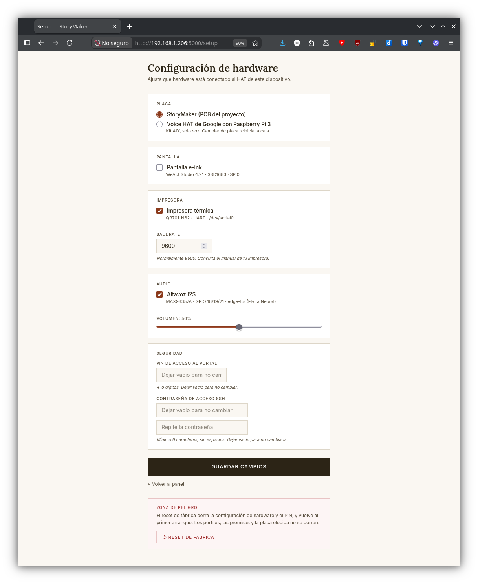

---

## 11. Llevar la máquina a otro sitio

Si cambias de aula, de centro o de red, la máquina no encontrará la WiFi que
conoce y levantará la suya para que la reconfigures.

**Si arranca y no la encuentras en la red:** busca la WiFi
**`StoryMaker-Setup`** desde el móvil, conéctate (no tiene contraseña) y se
abrirá sola la página para elegir la red nueva.

**Si quieres forzarlo a propósito:** enchúfala **con el botón ya pulsado** y no
lo sueltes hasta que el LED parpadee rápido, unos 20–30 segundos después. Antes
parpadea despacio mientras lo detecta.

Recuerda que la Pi Zero 2W **sólo se conecta a redes de 2,4 GHz**. Si el router
del sitio nuevo sólo da 5 GHz, no la verá.

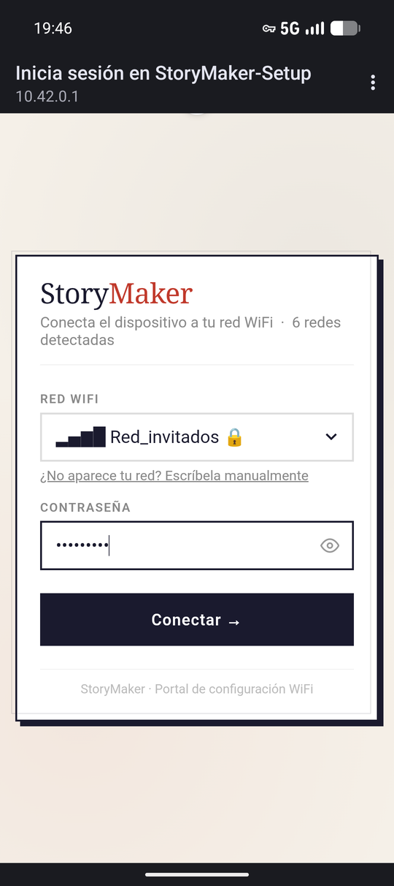

---

## 12. Empezar de cero

En **⚙ Hardware**, abajo del todo, **↺ Reset de fábrica**. Pide confirmación.

Devuelve el dispositivo al estado de primer arranque: vuelve a pedir el PIN
inicial y a pasar por el asistente de configuración.

**No borra los perfiles ni las premisas.** Lo que has escrito sigue ahí.

---

## 13. Dudas frecuentes

**¿Puedo usarla sin internet?**
Sí. Sólo necesita una red local, y ni siquiera eso si usas el botón. Lo único
que pide internet es la voz principal del altavoz: sin conexión usa una voz
local, de peor calidad. Al perder la red, la primera frase tarda un par de
segundos más, mientras la máquina lo comprueba.

**¿Puedo tener varias máquinas en el mismo centro?**
Sí, pero todas responderán al nombre `storymaker.local` y se pisarán. Con más
de una, entra por la IP de cada una.

**¿Pueden conectarse varios alumnos al panel a la vez?**
Sí. Es una Raspberry Pi pequeña, así que con diez o quince a la vez irá lenta,
pero funciona.

**¿Se pierde lo que escribo si actualizo la máquina?**
Si la actualizas grabando la imagen nueva, sí: la tarjeta empieza de cero.
Copia antes tus listas a un `.txt` y vuelve a importarlas después (8). Quien
la actualiza desde el código conserva la configuración y los perfiles.

**La impresora saca el papel en blanco.**
Casi siempre es el rollo puesto del revés. El papel térmico sólo imprime por
una cara.

**La pantalla se ha quedado con una premisa antigua.**
Es normal: el e-ink mantiene la última imagen aunque esté apagada. No gasta
nada por estar ahí.

**¿Y si olvido el PIN?**
Haciendo un reset de fábrica desde... el panel, al que no puedes entrar.
Si ocurre, hay que volver a grabar la tarjeta (o, si sabes manejar SSH,
entrar al dispositivo y cambiarlo desde ahí).
Apúntalo en algún sitio.

---

## 14. Ideas para el taller

- **Deja que pulsen ellos.** El botón físico es media experiencia; desde el
  panel pierde la gracia.
- **Prepara un perfil por sesión.** Importar un `.txt` lleva un minuto y
  permite ajustar el tono al grupo que tengas delante.
- **Los tiques funcionan muy bien.** Cada alumno se lleva el suyo y lo pega en
  el cuaderno. Es la salida que más engancha.
- **Cuenta las frases antes de empezar.** Mira la categoría más corta: ese es
  el número de premisas que te da la sesión. Si tienes 25 alumnos, necesitas al
  menos 25 en cada lista.
- **Las combinaciones absurdas son material.** Las que salen torcidas suelen
  dar los mejores textos. Vale la pena dejarlas correr en lugar de pulsar otra
  vez.
