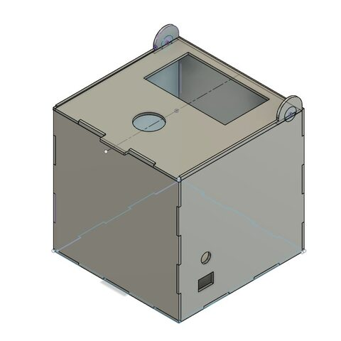
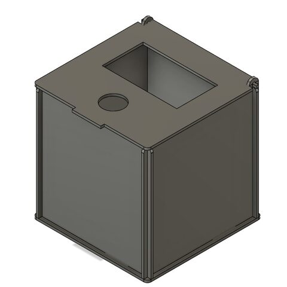

# Envolvente

Archivos para fabricar la caja de la máquina.

La caja de base del proyecto es la **impresa en 3D**: sin adornos, la más
sencilla y asequible de fabricar, porque solo pide una impresora 3D. Hay
siete versiones, una por cada combinación de salidas (pantalla e-ink,
impresora térmica y altavoz), para que la caja lleve justo los huecos de lo
que vayas a montar, y un juego de accesorios común a todas.

Si prefieres otro material, por estética o porque tienes una cortadora láser
a mano, hay dos alternativas:

- **Madera**, de corte láser.
- **Acrílico**, de corte láser, con bisagras y esquineras impresas en 3D.

Las tres son un cubo de 160 mm. Las de madera y acrílico son obra del
alumnado y el profesorado del ciclo de Grado Medio en Conformado por Moldeo de
Metales y Polímeros del **IES Virgen del Pilar** (Zaragoza), con tapa
abatible; en la tapa van la ventana de la pantalla e-ink y el hueco del botón,
y en un lateral, dos orificios más.

| Variante | Qué hace falta para fabricarla |
|---|---|
| Impresa en 3D | Impresora 3D |
| Madera | Cortadora láser y tablero |
| Acrílico | Cortadora láser, plancha de metacrilato e impresora 3D |

Los troqueles de la **caja de cartón** no están aquí: van con sus diseños
gráficos en [`artes-graficas/`](../artes-graficas/README.md).

---

## Muestrario

Modelos de cada versión. Pulsa una imagen para verla a tamaño completo.

**Impresa en 3D.** Vistas del diseño en su posición de uso: el botón arriba
y la cara abierta abajo, que cierra la tapa inferior. Para imprimir se ponen
al revés (ver [Parámetros de impresión](#par%C3%A1metros-de-impresi%C3%B3n)).

| E-ink | Impresora | Altavoz | Impresora + e-ink |
|:-:|:-:|:-:|:-:|
|  |  |  |  |

| Altavoz + e-ink | Impresora + altavoz | Las tres | Accesorios |
|:-:|:-:|:-:|:-:|
|  |  |  |  |

**Corte láser.**

| Madera | Acrílico |
|:-:|:-:|
|  |  |

---

## Estructura

| Carpeta | Contenido |
|---|---|
| `01 fuentes/` | Ficheros editables del programa de CAD en que se diseñaron |
| `02 producción/` | Lo que va a la máquina: `dxf/` para cortar con láser, `stl/` para imprimir, `3mf/` con el proyecto listo para el laminador, y `iges/` con el modelo 3D de cada pieza |
| `03 imágenes/` | Modelos de cada pieza y del conjunto, y vídeos del montaje y del corte |

Dentro de cada una hay una subcarpeta por modelo, con el mismo número en las
tres. Cada pieza se llama igual en todas: `tapa.dxf`, `tapa.iges` y
`tapa.jpg` son la misma pieza, como `caja_eink.stl` y `caja_eink.png`.

---

## Modelos

| | Modelo | Fabricación | Estado |
|---|---|---|---|
| 00 | **Impresa en 3D** | Impresión 3D en PLA, en siete versiones según las salidas, con un juego de accesorios común. Se cierra por debajo con una tapa y cuatro tornillos, también impresos | ✅ |
| 01 | **Madera** | Corte láser en tablero de 2,6 mm, con uniones de dedos. La tapa gira sobre dos discos | ✅ |
| 02 | **Acrílico** | Paneles de corte láser en metacrilato de 3,2 mm, que se montan con bisagras y esquineras impresas en 3D | ✅ |

---

## Caja impresa en 3D

### Qué imprimir

- **Con Bambu Studio u OrcaSlicer:** abre
  [`storymaker-set-completo.3mf`](02%20producci%C3%B3n/00%20Impresa%20en%203D/3mf/storymaker-set-completo.3mf)
  y lamina la placa de tu versión, más las de accesorios que necesites
  (placas 8 a 10, ver [Versiones](#versiones)). El proyecto está preparado
  para una Bambu Lab P1S y no viene laminado: si tu impresora es otra, ajusta
  su perfil antes. Los STL son el diseño de referencia; el 3MF se rehace a
  partir de ellos.
- **Con cualquier otro laminador:** imprime el STL de la caja de tu versión y
  [`accesorios.stl`](02%20producci%C3%B3n/00%20Impresa%20en%203D/stl/accesorios.stl),
  quitando las piezas que no te hagan falta (ver [Accesorios](#accesorios)).
- **Para elegir versión,** mira qué salidas vas a montar y busca su fila en la
  tabla de [Versiones](#versiones). Todas usan la misma placa base.

### Versiones

| Versión | E-ink | Impresora | Altavoz | STL de la caja | Placa del 3MF | Accesorios de la versión |
|---|:-:|:-:|:-:|---|:-:|---|
| E-ink | ✔ | | | `caja_eink.stl` | 1 | Marco del e-ink |
| Impresora | | ✔ | | `caja_imp.stl` | 2 | — |
| Altavoz | | | ✔ | `caja_alt.stl` | 3 | — |
| Impresora + e-ink | ✔ | ✔ | | `caja_imp-eink.stl` | 4 | Marco del e-ink |
| Altavoz + e-ink | ✔ | | ✔ | `caja_alt-eink.stl` | 5 | Marco del e-ink |
| Impresora + altavoz | | ✔ | ✔ | `caja_imp-alt.stl` | 6 | — |
| Las tres | ✔ | ✔ | ✔ | `caja_imp-alt-eink.stl` | 7 | Marco del e-ink |

Todas las cajas miden 160 × 160 × 160 mm. `accesorios.stl` agrupa los 38
accesorios en una sola placa (199 × 497 × 36). Cada fichero tiene su vista con
el mismo nombre en `03 imágenes/00 Impresa en 3D/`; las placas 8 a 10 del 3MF,
en `marco_eink.png`, `accesorios.png` y `tapa_tornillos.png`.

Todas llevan además la **tapa inferior** y **4 tornillos cortos** (placa 10),
**4 patas bajas** para la placa base y, si usas powerbank, **4 patas altas**
(placa 9). El marco del e-ink está en la placa 8. La tornillería comercial,
en [Tornillería](#torniller%C3%ADa).

En el 3MF cada placa lleva el nombre de su versión (*Display*, *Impresora +
altavoz*...); las tres de accesorios son *Marco interior display e-ink*,
*Accesorios* y *Tapa inferior + tornillos cortos*.

### Accesorios

Todos van juntos en `accesorios.stl`, ya colocados para imprimir.

| Pieza | Medidas | En el fichero | Para qué sirve |
|---|---|:-:|---|
| Tapa inferior | 152 × 152 × 4 | 1 | Cierra la caja por la cara abierta |
| Tornillo corto | 25 × 18 × 18 | 8 | Tornillo moleteado que fija la tapa inferior: 4 por caja |
| Tornillo largo | 36 × 18 × 18 | 4 | Como el corto, para cajas que lo necesiten más largo, como las de cartón o madera |
| Tuerca | 16 × 16 × 8 | 4 | Tuerca cuadrada para los tornillos, en esas mismas cajas |
| Pata baja | 14 × 12 × 6 | 8 | Patas de tres brazos para la placa base: 4 por caja, las demás de repuesto |
| Pata alta | 14 × 12 × 12 | 8 | Patas de tres brazos para el powerbank, si lo usas: 4 por caja, las demás de repuesto |
| Llave | 70 × 20 × 7 | 1 | Para poner y quitar las patas |
| Marco del e-ink | 120 × 120 × 4 | 1 | Marco interior de la pantalla e-ink |
| Rejilla grande | Ø 93 × 6 | 1 | Para las cajas de madera o acrílico: en lugar de mecanizar la rejilla del altavoz, se hace un agujero grande y se tapa con esta. Altavoz de 78 mm |
| Rejilla pequeña | Ø 52 × 6 | 1 | Lo mismo, para altavoz de 40 mm |
| Soporte de Pi Zero | 64 × 29 × 6 | 1 | Para montar la Raspberry Pi Zero sin la placa base, con el sistema de conexión que elijas (cables a los pines, etc.) |

Las cajas impresas con altavoz no necesitan rejilla aparte: la llevan hecha en el lateral.

**Imprimir solo algunas.** Abre `accesorios.stl` y sepáralo en piezas:

- **Bambu Studio y OrcaSlicer:** clic derecho sobre el objeto › *Split* ›
  *To objects* (*Dividir › En objetos*).
- **PrusaSlicer:** selecciona el objeto y pulsa *Split to objects* en la barra
  superior.

Cada pieza pasa a ser un objeto independiente: borra las que no quieras y
lamina el resto. En el 3MF ya vienen separadas por placas.

### Tornillería

La caja se cierra con sus tornillos impresos. Solo hacen falta tornillos
comerciales para fijar los componentes:

| Tornillo | Para qué |
|---|---|
| M3 × 6, los habituales de PCB | Placa base y powerbank, sobre sus patas |
| M2 × 15 | Pantalla e-ink |

### Parámetros de impresión

Orientativos: son los del proyecto 3MF, preparado para una Bambu Lab P1S.

| Parámetro | Valor |
|---|---|
| Material | PLA |
| Boquilla | 0,4 mm |
| Altura de capa | 0,20 mm |
| Perímetros | 2 |
| Capas sólidas | 5 arriba, 3 abajo |
| Relleno | 15 %, en rejilla |
| Soportes | En árbol, solo donde se marcan. En el 3MF los llevan pintados las cuatro versiones con e-ink; las demás no los necesitan |
| Adherencia | Borde automático. El 3MF usa la placa *Textured PEI Plate* de Bambu |
| Orientación | Cada caja boca abajo, con la cara abierta hacia arriba y el techo sobre la cama, como en el 3MF. **Los STL vienen en posición de uso** (cara abierta abajo): dales la vuelta al importarlos. Los accesorios, planos |

El 3MF no está laminado, así que no da tiempo ni filamento: te los calculará
el laminador para tu impresora.

### Montar la caja

Con la placa ya soldada y comprobada (ver [Montar la
placa](../hardware/README.md#montar-la-placa)):

1. **Imprime** la caja de tu versión, la tapa inferior, 4 tornillos cortos y
   4 patas bajas; si usas powerbank, también 4 patas altas, y si llevas
   pantalla, el marco del e-ink.
2. **Patas.** Coloca las patas con la llave impresa: las bajas para la placa
   y, si hay powerbank, las altas para él.
   <!-- PENDIENTE (Héctor): ¿las patas van en la tapa inferior? ¿a presión,
   roscadas? -->
3. **Placa y powerbank**, cada uno sobre sus patas con tornillos M3 × 6.
4. **Pantalla** (versiones con e-ink): por dentro de la ventana, sujeta con el
   marco del e-ink y 4 tornillos M2 × 15.
   <!-- PENDIENTE (Héctor): orden exacto pantalla/marco/caja y por dónde
   entran los tornillos. -->
5. **Botón** en el agujero de arriba, con su tuerca.
   <!-- PENDIENTE (Héctor): ¿el LED va dentro del pulsador o en otro agujero? -->
6. **Altavoz** (versiones con altavoz) detrás de la rejilla.
   <!-- PENDIENTE (Héctor): cómo se fija (pegamento, tornillos, a presión). -->
7. **Impresora** (versiones con impresora) en la ranura de arriba, desde
   fuera.
   <!-- PENDIENTE (Héctor): confirmar en la QR701 y la QR204. -->
8. **Conecta** los periféricos a la placa (ver [Conectar los
   periféricos](../hardware/README.md#4-conectar-los-perif%C3%A9ricos)) y
   pon la tarjeta grabada en la Pi.
9. **Cierra** con la tapa inferior y sus 4 tornillos cortos.

---

## Piezas de las cajas de corte láser

Medidas en milímetros, sacadas de los propios ficheros.

### 01 · Madera

| Pieza | Medidas | Cantidad | Notas |
|---|---|:-:|---|
| `suelo` | 160 × 160 | 1 | |
| `lado_a` | 160 × 160 | 1 | |
| `lado_a2` | 160 × 157,4 | 1 | |
| `lado_b` | 160 × 177,6 | 1 | Con la oreja y el eje de la bisagra (Ø 15) |
| `lado_b2` | 160 × 177,6 | 1 | Como `lado_b`, más dos orificios: Ø 12 y 19 × 13 |
| `tapa` | 161 × 162,4 | 1 | Ventana de la pantalla de 104 × 57 y hueco del botón de Ø 30 |
| `bisagra` | Ø 14,9 | 2 | Disco sobre el que gira la tapa |

### 02 · Acrílico

Paneles, para cortar con láser (`dxf/`):

| Pieza | Medidas | Cantidad | Notas |
|---|---|:-:|---|
| `base` | 160 × 160 | 1 | |
| `frontal_trasera` | 160 × 160 | 2 | Una para cada cara |
| `lateral` | 160 × 169 | 1 | Con la oreja de la bisagra y dos orificios: Ø 12 y rectangular |
| `lateral_2` | 160 × 169 | 1 | Con la oreja de la bisagra |
| `tapa` | 160 × 165 | 1 | Ventana de la pantalla de 104 × 57 y hueco del botón de Ø 30 |

Bisagras, esquineras y marcos, para imprimir en 3D (`stl/`). Las bisagras y
las esquineras son las que sujetan los paneles entre sí: sin ellas la caja no
se monta.

| Pieza | Medidas | Notas |
|---|---|---|
| `bisagra_tapa` | 78 × 14,5 × 8 | Bisagra de la tapa |
| `bisagra_tope` | 100 × 29 × 11 | Bisagra con tope. Montaje en `montaje_bisagra.jpg` |
| `esquinera_tope` | 24 × 20 × 20 | Esquinera con tope |
| `esquinera_tope_izq` | 24 × 20 × 20 | Variante izquierda |
| `esquinera_tope_dch` | 24 × 20 × 20 | Variante derecha |
| `marco_1` | 117 × 69 × 4 | Marco de la ventana de la pantalla |
| `marco_2` | Ø 23 × 4 | Aro |
| `marco_3` | 25 × 19 × 4 | Marco del orificio rectangular |
| `marco_4` | Ø 17 × 4 | Aro del orificio de Ø 12 |
| `placa` | — | Solo fuente, sin exportar a STL |

Los marcos también sirven para la caja de madera: su ventana y sus orificios
miden lo mismo.

---

## Cortar y montar

**Corte láser.** Los DXF están en milímetros, con todos los contornos en una
sola capa. Están dibujados para el espesor que indica la tabla de modelos: si
tu tablero o tu plancha miden otra cosa, las uniones no encajarán. Los
ficheros no indican compensación de *kerf* (el ancho de material que se
lleva el láser al cortar, unas décimas de milímetro), así que conviene cortar primero
una pieza pequeña y probar el encaje antes de lanzar el juego completo.

**Impresión 3D.** Los STL están en milímetros. Los de la caja impresa llevan
sus parámetros orientativos en
[Parámetros de impresión](#par%C3%A1metros-de-impresi%C3%B3n); los de las piezas
del acrílico no se acompañan de parámetros.

En `03 imágenes/` hay vídeos del ensamblaje de las cajas de madera y
acrílico, pieza a pieza, y uno de la de madera cortándose.

---

## Editar los diseños

- La **caja impresa en 3D** y sus accesorios se diseñaron en Tinkercad, que
  solo exporta mallas: su forma editable son los propios STL. Cómo
  reimportarlos en Tinkercad o en FreeCAD, en
  [`01 fuentes/00 Impresa en 3D/`](01%20fuentes/00%20Impresa%20en%203D/README.md).
- Los **paneles de madera y acrílico** se diseñaron en Autodesk Fusion. Sus
  ficheros nativos no se han publicado; para modificar una pieza, importa su
  `.iges` o edita directamente el `.dxf`.
- Las **piezas impresas del acrílico** se diseñaron en Autodesk Inventor
  2025: sus fuentes son los `.ipt` de `01 fuentes/02 Acrílico/`.

Los `.iges` se abren en cualquier programa de CAD, también en programas
libres como **FreeCAD**, y los `.dxf` en **LibreCAD**, **Inkscape** o el
programa de la cortadora.

---

## Licencia

Este directorio se publica bajo la
**CERN Open Hardware Licence v2 — Strongly Reciprocal**
([`CERN-OHL-S-2.0`](LICENSE)), la misma que el resto del hardware del
proyecto. Puedes fabricar, modificar y distribuir estos diseños, también con
fines comerciales, siempre que publiques las fuentes de lo que derives bajo la
misma licencia y conserves los avisos de autoría.

Atribución sugerida:

> Caja impresa en 3D y sus accesorios:
> *La asombrosa máquina de generar historias* (Asociación Atrapavientos).
> CERN-OHL-S-2.0.

> Diseño de las cajas de madera y acrílico: alumnado y profesorado del
> IES Virgen del Pilar, para
> *La asombrosa máquina de generar historias* (Asociación Atrapavientos).
> CERN-OHL-S-2.0.
