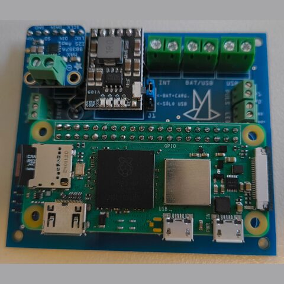
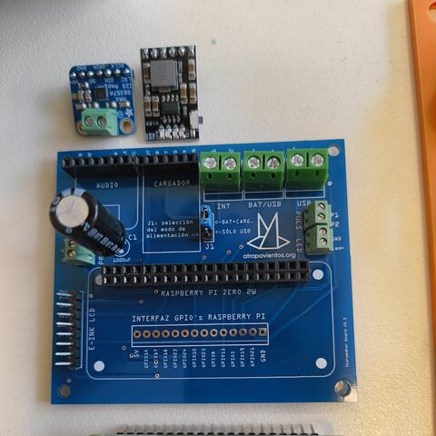
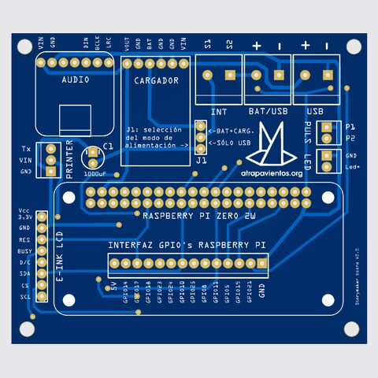
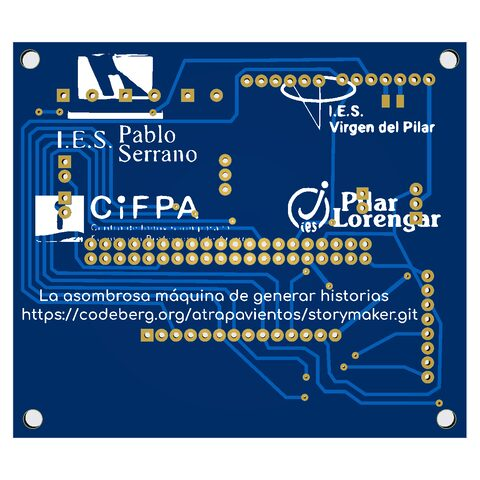
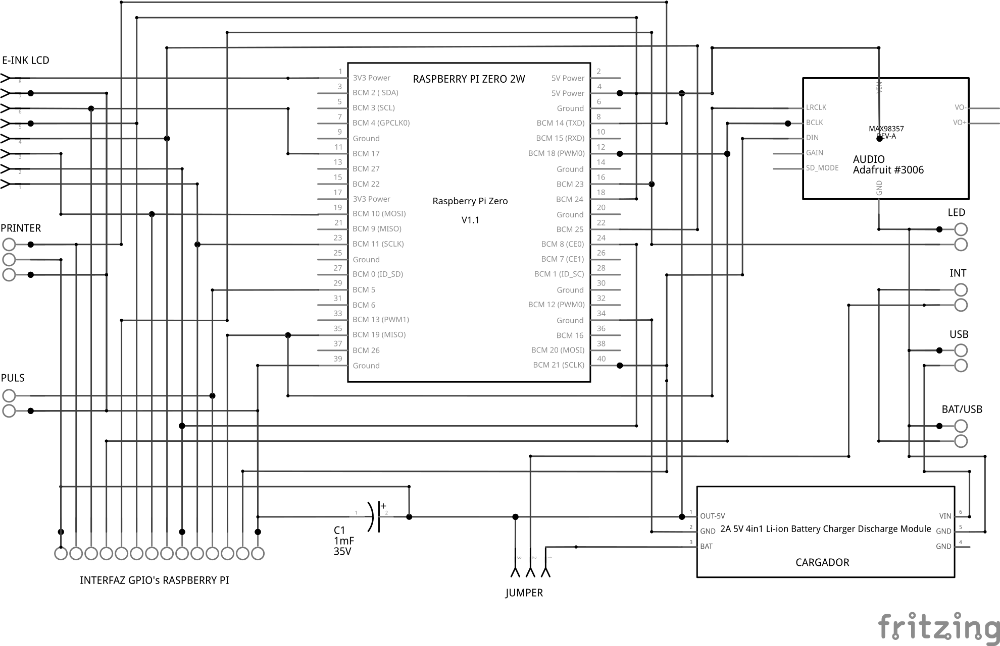
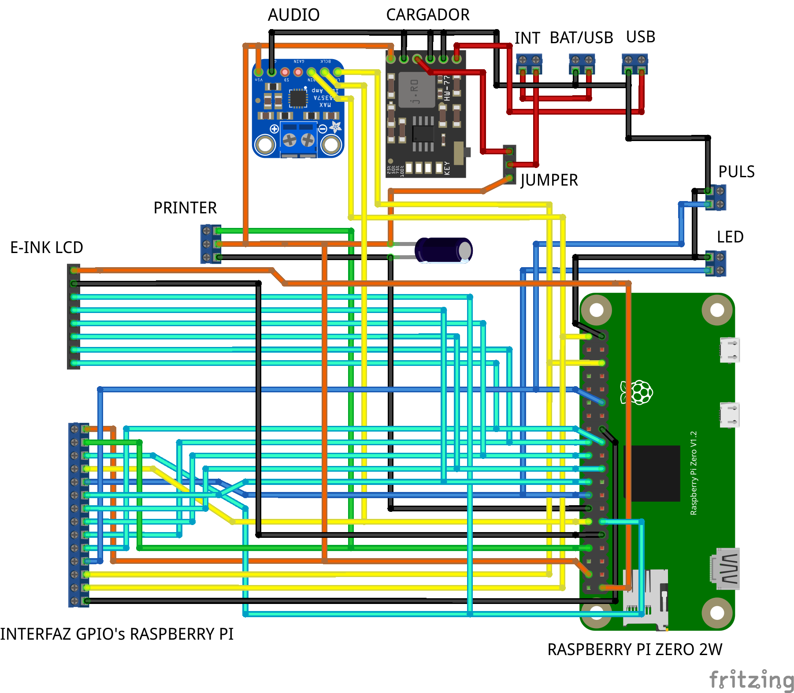
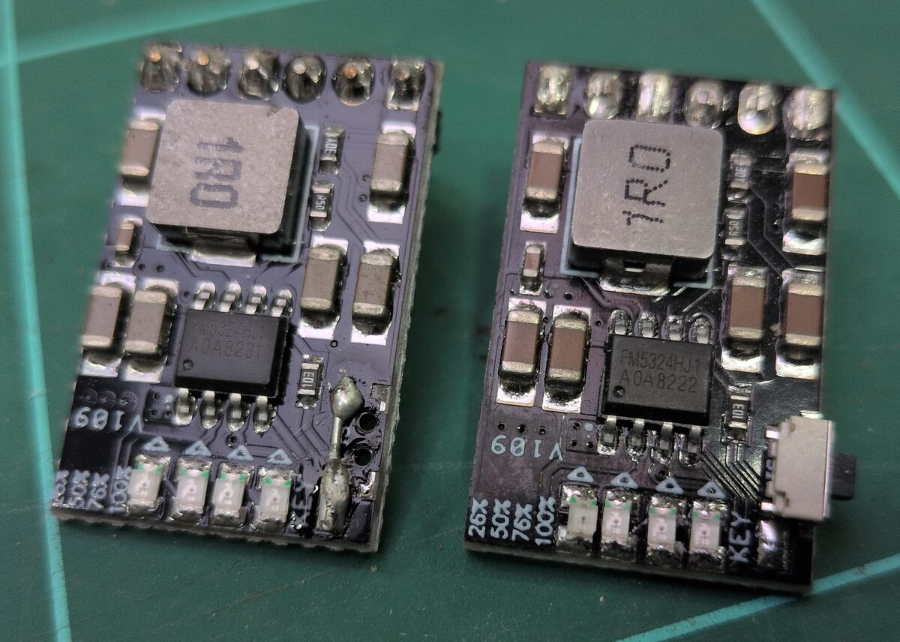

# Hardware

Placa base de la máquina: un *hat* para Raspberry Pi Zero 2W que reúne en un
solo circuito la Pi, el amplificador de audio, el cargador de batería y los
conectores de la pantalla, la impresora, el botón y el LED. Con ella no hay
que soldar cables a la Pi: cada periférico va a su conector, rotulado en la
serigrafía.

La versión publicada es la **v2**, la que dice la serigrafía: 80 × 70 mm, dos caras y solo componentes
de agujero pasante, que se sueldan a mano.

---

## Muestrario

Pulsa una imagen para verla a tamaño completo.

| Montada | Placa y módulos |
|:-:|:-:|
|  |  |
| **Cara (render)** | **Dorso (render)** |
|  |  |

Hay también una [vista 3D](pcb/imagenes/v2-3d.png) y el trazado de pistas de
cada cara en SVG, a escala 1:1: impreso al 100 %, sirve para comprobar el
tamaño y los taladros antes de encargarla
([cara](pcb/imagenes/v2-layout-cara.svg), [dorso](pcb/imagenes/v2-layout-dorso.svg)).

---

## Esquema

En [SVG](esquemas/v2-esquema.svg), para ampliarlo sin pixelar o imprimirlo.

El mismo circuito en vista de montaje, con los módulos dibujados como son y
cada cable de un color según su función (en [SVG](esquemas/v2-croquis.svg)):

---

## Estructura

| Carpeta | Contenido |
|---|---|
| `esquemas/` | Esquema eléctrico y croquis de montaje, en PNG y SVG |
| `pcb/gerber/` | Lo que se manda a fabricar: el `.zip` con los Gerber y el fichero de taladros |
| `pcb/fritzing/` | El diseño editable, para abrirlo y modificarlo en Fritzing |
| `pcb/imagenes/` | Fotos de la placa real, renders de las dos caras, vista 3D y trazado de pistas en SVG |
| [`bom/`](bom/) | Lista de materiales por bloques, según las salidas y la alimentación *(borrador)* |

Los ficheros llevan la versión de la placa en el nombre (`v2`).

---

## Conectores

Los nombres son los de la serigrafía. GPIO en numeración BCM; entre
paréntesis, el pin físico de la Pi.

| Conector | Se conecta a | Pines |
|---|---|---|
| `E-INK LCD` | Pantalla e-ink WeAct de 4,2" | `Vcc 3,3V` (1) · `GND` · `RES` GPIO 17 (11) · `BUSY` GPIO 24 (18) · `D/C` GPIO 25 (22) · `SDA` GPIO 10 (19) · `CS` GPIO 8 (24) · `SCL` GPIO 11 (23) |
| `PRINTER` | Impresora térmica | `Tx` GPIO 14 (8), al RX de la impresora · `VIN` 5 V · `GND` |
| `AUDIO` | Amplificador MAX98357A (Adafruit 3006) | `VIN` 5 V · `GND` · `DIN` GPIO 21 (40) · `BCLK` GPIO 18 (12) · `LRC` GPIO 19 (35) |
| `PULS` | Botón | `P1` · `P2`: GPIO 5 (29) y GND, en cualquier orden |
| `LED` | LED de estado | `GND` · `Led+` GPIO 23 (16) |
| `CARGADOR` | Módulo cargador y elevador de batería de litio, 2 A / 5 V | `VOUT` · `GND` · `BAT` · `GND` · `GND` · `VIN` |
| `BAT/USB` | Alimentación principal: la batería o una fuente USB de 5 V, según `J1` | `+` · `−` |
| `USB` | Entrada de carga de la batería | `+` · `−` |
| `INT` | Interruptor de encendido | `S1` · `S2` |
| `J1` | Puente de selección del modo de alimentación | ver abajo |
| `INTERFAZ GPIO's RASPBERRY PI` | Todas las señales anteriores, más 5 V y GND, para medir o ampliar | `5V` · GPIO 14, 17, 18, 23, 24, 10, 25, 8, 11, 5, 19, 21 · `GND` |

La impresora solo recibe: la placa no cablea su TX de vuelta a la Pi. En el
amplificador, `SD` y `GAIN` quedan sin conectar, que es su configuración por
defecto, y salen a dos pads del dorso por si alguien quiere cambiarla.

### Alimentación y el puente J1

La alimentación entra por `BAT/USB`, pasa por el interruptor `INT` y llega a
`J1`, que decide adónde va:

| Posición de `J1` | Serigrafía | `BAT/USB` | `CARGADOR` | `USB` | Cómo funciona |
|---|---|---|---|---|---|
| Arriba | `BAT+CARG.` | La **batería** LiPo de una celda | Módulo MH-CD42 montado | Toma de carga | La batería va al cargador, que la eleva a 5 V para todo el circuito. Por `USB` se carga |
| Abajo | `SÓLO USB` | Una **fuente USB de 5 V** o la salida de un powerbank | Vacío | Vacío | Los 5 V van directos al circuito |

Qué comprar para cada opción, en la [lista de materiales](bom/).

> **Pon `J1` antes de conectar nada.**
>
> - Con el puente arriba, `BAT/USB` va al pin de batería del cargador: una
>   fuente de 5 V ahí puede dañarlo.
> - Con el puente abajo, una LiPo quedaría conectada directamente a los 5 V,
>   sin pasar por el cargador.

- **Respeta la polaridad.** La placa no tiene fusible ni diodo de protección:
  con `J1` abajo, `BAT/USB` llega directo al raíl de 5 V que alimenta la Pi.
- **Con `J1` abajo, no montes el cargador.** Su salida está siempre unida al
  raíl de 5 V.
- **Para cargar la LiPo, el interruptor tiene que estar cerrado.** `INT` está
  entre la batería y el cargador; abierto, la batería queda desconectada.
- **El cargador necesita un puente para arrancar con el interruptor.** Tal
  como viene, el MH-CD42 no da salida hasta que se pulsa su botón lateral
  (`KEY`). Quítale el pulsador y une sus contactos con un hilo, como el de la
  izquierda en la foto: así se activa en cuanto recibe tensión al cerrar el
  interruptor, que es lo que hacía el pulsador.

---

## Fabricar la placa

El `.zip` de [`pcb/gerber/`](pcb/gerber/) se sube tal cual a cualquier
servicio de fabricación de PCB (JLCPCB, PCBWay, Aisler…), sin descomprimirlo.
El servicio detecta solo el tamaño y las capas. Lo demás se puede dejar con
los valores habituales:

| Opción | Valor |
|---|---|
| Capas | 2 |
| Medidas | 80 × 70 mm |
| Grosor | 1,6 mm |
| Taladros | Los más pequeños, 0,4 mm (vías) |
| Color de la máscara | El que quieras; los renders son azules |
| Acabado | HASL, el más común |

El `.zip` incluye también un fichero de colocación (`_pnp.xy`) que genera
Fritzing. No hace falta: todos los componentes son de agujero pasante y la
placa se encarga sin montaje.

Antes de pedirla, conviene repasar la vista previa que muestra el propio
servicio al subir el `.zip`: deben verse las dos caras como en el muestrario.

---

## Montar la placa

Todo se suelda a mano con un soldador corriente. Lo que necesitas está en la
[lista de materiales](bom/), bloque `BASE` más los de tus salidas y tu
alimentación.

> **Compra una Raspberry Pi Zero 2W sin pines (no la «WH»).** La Pi se pincha
> **encima** de la placa, con sus componentes hacia arriba, así que su
> conector de 40 pines va soldado **por debajo**, al revés de lo habitual. La
> Zero 2 WH viene con el conector ya soldado por arriba y no sirve.

### 1. Soldar la placa

De lo más bajo a lo más alto, para que la placa se apoye plana en la mesa
mientras sueldas:

1. **Zócalo de la Pi** (hembra 2×20), en `RASPBERRY PI ZERO 2W`.
2. **Zócalos de los módulos:** hembra 1×7 en `AUDIO` y, si usas batería
   LiPo, hembra 1×6 en `CARGADOR`. Soldarlos permite cambiar un módulo sin
   desoldar nada.
3. **Pines de `J1`** (macho 1×3) y **pines de `E-INK LCD`** (macho acodada
   1×8, con las puntas hacia el borde de la placa).
4. **Bornas de tornillo**, con la boca hacia fuera de la placa: `INT`,
   `BAT/USB` y `USB` (las grandes), y `PULS`, `LED` y `PRINTER`.
5. **C1**, el condensador electrolítico de 1000 µF, el último porque es lo más alto. **Tiene
   polaridad:** la pata corta, la del lado de la franja con signos «−», es
   el negativo; colócalo según la marca de polaridad de su huella en la
   serigrafía. Si estorba, se puede tumbar
   doblando las patas, como en la foto del interior en el [manual de
   despliegue](../docs/manuales/despliegue.md#1-material-necesario).

Solo si vas a usarla: la fila `INTERFAZ GPIO's RASPBERRY PI`, que repite las
señales para medir o ampliar. Las máquinas montadas la dejan sin soldar.

### 2. Preparar la Pi y los módulos

- **Pi:** suelda la tira macho 2×20 **por la cara de abajo**, con los pines
  hacia abajo.
- **Amplificador:** suelda su tira de pines y su borna para el altavoz, que
  vienen en la bolsa del módulo.
- **Cargador MH-CD42** (solo con LiPo): quítale el pulsador y puentea sus
  contactos, como se explica en [Alimentación y el puente
  J1](#alimentaci%C3%B3n-y-el-puente-j1).

### 3. Comprobar antes de dar corriente

Con la placa todavía sin módulos ni Pi:

- [ ] **Sin cortos:** con el polímetro en continuidad, entre los pads `5V` y
  `GND` de la fila `INTERFAZ GPIO's RASPBERRY PI` no debe pitar de forma
  continua (un pitido breve al principio es C1 cargándose). Repasa las soldaduras con lupa: un puente de
  estaño entre dos pines vecinos es el fallo más común.
- [ ] **`J1`** en su posición: `SÓLO USB` para cargador USB o powerbank,
  `BAT+CARG.` para LiPo.
- [ ] **C1** con la pata negativa en su sitio.

Después, pincha los módulos y la Pi:

- [ ] **Amplificador y cargador** con sus pines coincidiendo con los nombres
  de la serigrafía (`VIN`, `GND`, `DIN`…; `VOUT`, `BAT`, `VIN`…).
- [ ] **Pi** con sus componentes hacia arriba y la ranura de la tarjeta en el
  mismo lado que en la foto de la placa montada. Sus cuatro agujeros caen
  sobre los de la placa.
- [ ] Sin el cargador si `J1` está en `SÓLO USB`.

### 4. Conectar los periféricos

La alimentación entra por la borna `BAT/USB`, no por el micro-USB de la Pi.

| Periférico | Dónde | Cómo |
|---|---|---|
| Interruptor | `INT` | Sus dos cables, en cualquier orden. Al interruptor van con terminales faston |
| Cargador USB, powerbank o LiPo | `BAT/USB` | **Respeta `+` y `−`:** la placa no tiene protección contra la polaridad invertida |
| Toma de carga (solo LiPo) | `USB` | `+` y `−` |
| Botón | `PULS` | Los dos cables del contacto, en cualquier orden |
| LED del botón | `LED` | El `+` del LED a `Led+` y el `−` a `GND`. Va dentro del propio pulsador, con su resistencia incorporada |

Al pulsador, los cuatro cables van con terminales faston.
| Impresora | `PRINTER` | `VIN` y `GND` a su alimentación; `Tx`, al RX de la impresora |
| Pantalla e-ink | `E-INK LCD` | Cable de 8 hilos, **cada uno por el nombre de su señal**, no por la posición: el orden de los pines de la pantalla no coincide con el de la placa |
| Altavoz | La borna del propio amplificador | Sus dos cables |

Con todo conectado, graba la tarjeta (Ruta A del [manual de
despliegue](../docs/manuales/despliegue.md)), métela en la Pi y cierra el
interruptor. El LED se queda fijo cuando la máquina está lista.

---

## Editar el diseño

La placa está diseñada en **Fritzing** 1.0.8. El fichero
[`storymaker_pcb_v2.fzz`](pcb/fritzing/storymaker_pcb_v2.fzz) lleva dentro
las piezas que no vienen con el programa (el amplificador y el cargador), así
que se abre sin instalar nada más.

Fritzing es software libre. En Linux está en los repositorios de muchas
distribuciones y en Flathub; en su web oficial, la descarga de los binarios
pide una aportación.

Para volver a fabricar después de un cambio: *File → Export → for
Production → Extended Gerber*, y comprimir en un `.zip` los ficheros que
genera.

---

## Licencia

Este directorio se publica bajo la
**CERN Open Hardware Licence v2 — Strongly Reciprocal**
([`CERN-OHL-S-2.0`](LICENSE)). Puedes fabricar, modificar y distribuir la
placa, también con fines comerciales, siempre que publiques las fuentes de lo
que derives bajo la misma licencia y conserves los avisos de autoría.

Los **logotipos** de la serigrafía (Atrapavientos, IES Pablo Serrano,
IES Virgen del Pilar, IES Pilar Lorengar y CIFPA) pertenecen a sus
titulares y no entran en esa licencia. Si derivas tu propia placa, puedes
quitarlos.

Las piezas de Fritzing de terceros que van dentro del `.fzz` conservan su
autoría; ver [`CREDITS.md`](../CREDITS.md).
